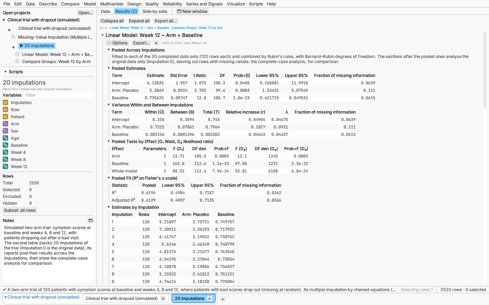
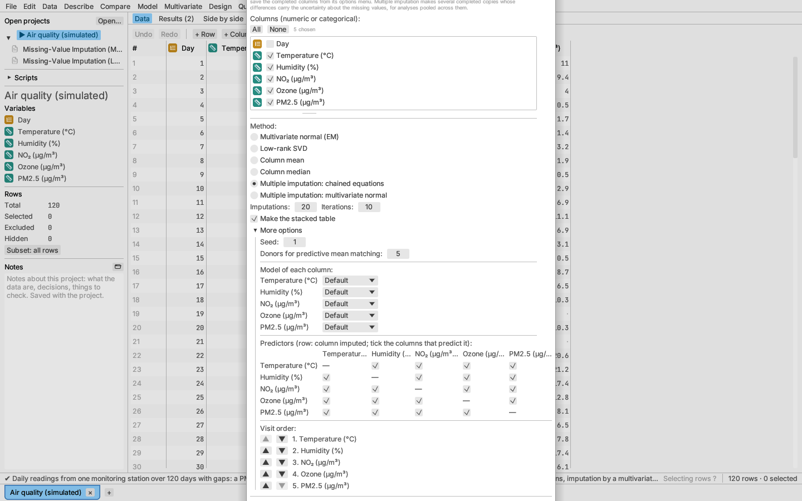
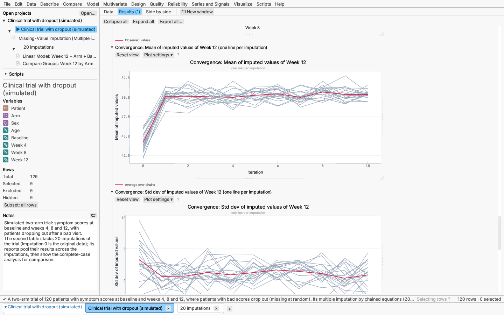

# Multiple imputation

Filling each missing value once ([Missing values and imputation](missing-values.md))
gives one completed table, and analyses of it treat the filled-in values as
if they had been measured, so their standard errors are too small and their
p-values too optimistic. **Multiple imputation** (Rubin 1987) fills the gaps
*m* times instead, each time with values drawn from their predictive
distribution, so the completed copies differ where the data say little. An
analysis is run on each copy and the *m* results are combined; the spread
between copies adds the uncertainty about the missing values to the usual
sampling uncertainty.

The workflow has three steps:

1. **Data ▸ Impute missing values…** with one of the two *Multiple
   imputation* methods makes the imputations and a report to check them.
2. The imputations go into a **stacked table**: the original rows
   (Imputation 0) followed by each completed copy (Imputation 1 to *m*).
3. Analyses on the stacked table are **pooled across imputations**: fitted
   to each copy and combined by Rubin's rules.

To see it worked through, open **File ▸ Open sample data ▸ Projects ▸
Clinical trial with dropout**: a simulated two-arm trial in which patients
with bad scores leave early, its multiple imputation, and the stacked table
with a pooled analysis of covariance and a pooled comparison of the arms.

## Making the imputations

In **Data ▸ Impute missing values…** tick the columns and choose a method:

| Method | How copies are made | Columns |
|---|---|---|
| **Multiple imputation: chained equations** | Fully conditional specification (van Buuren & Groothuis-Oudshoorn 2011): each column with missing values in turn is filled from a model of it given the other columns, cycling through the columns for a number of *iterations*, one chain per imputation. | Continuous and categorical (text, nominal or ordinal) |
| **Multiple imputation: multivariate normal** | Data augmentation (Schafer 1997): starting from the EM estimates, missing values are drawn given the current mean and covariance (I-step), then a mean and covariance are drawn given the completed data (P-step: inverse Wishart, then normal), and so on. | Continuous only |

The settings are:

- **Imputations** (*m*, default 20). More imputations make pooled
  p-values and intervals repeatable; 20 is enough for most analyses, more
  when much information is missing (the *fraction of missing information*
  in pooled reports is a guide: *m* of about 100 × that fraction).
- **Iterations** of each chain before its copy is taken (10 for chained
  equations, 50 for the normal model). Check the convergence plots in the
  report.
- **Make the stacked table** (on by default) adds the stacked table to the
  project when the report is made.
- **More options:** the **Seed** (the same seed makes the same
  imputations; chain *l* uses seed + *l* − 1), and for chained equations:
  - **Donors for predictive mean matching** (5).
  - **Model of each column**. *Default* is predictive mean matching for a
    continuous column, logistic regression for a column of two categories,
    multinomial logit for more, and *not imputed* for a column without
    missing values (it still predicts the others).
    - *Predictive mean matching*: a Bayesian regression of the column on the
      others gives drawn coefficients; each missing value is copied from one
      of the 5 observed rows whose predictions are nearest, chosen at
      random. Imputed values are always values that occur in the data, so
      skewed or bounded columns stay in range.
    - *Bayesian linear regression*: σ² is drawn from its scaled inverse
      χ² posterior and the coefficients from their normal posterior given
      σ², and the value is the drawn prediction plus normal noise.
    - *Logistic regression* and *Multinomial logit*: the model is fitted by
      Newton's method with a small ridge, coefficients are drawn from their
      approximate normal posterior, and a category is drawn from the drawn
      probabilities.
    - *Not imputed*: the column's missing values are left missing.
  - **Predictors**: a grid with one row per imputed column; untick a box so
    that column no longer predicts the row's column (for example a later
    measurement that should not predict an earlier one).
  - **Visit order**: the order the columns are filled in within each
    iteration (▲ and ▼ move a column).

Rows excluded from analyses take no part. The methods assume values are
**missing at random**: whether a value is missing may depend on the row's
observed values but not on the missing value itself. Include the columns
that predict missingness (in a trial, the earlier visits) among the
imputation columns even when the analysis will not use them.

## The report

Besides the missing-data patterns and pattern map of every imputation
report:

- **Imputation Models:** each column's kind, number of missing values,
  method, predictors and place in the visit order.
- **Means Pooled Across m Imputations:** each continuous column's observed
  mean and its mean pooled over the completed copies by Rubin's rules, with
  standard error, 95% interval and fraction of missing information.
- **Convergence** plots (up to eight imputed columns): the mean and the
  standard deviation of the imputed values of a continuous column (for a
  two-category column, the share imputed as its second category) at each
  iteration, one line per imputation's chain, with their average. Chains
  that cross each other and show no trend have converged.
- **Observed and Imputed Values:** a strip plot of the observed values at
  0 and each imputation's imputed values at its number. Imputed values
  should look plausible next to the observed ones; under missing at random
  they need not have the same distribution.
- **Densities:** the kernel density of the observed values (bold) and of
  each imputation's imputed values (thin).
- **Categories:** for a categorical column, the share of each category
  among observed and among imputed values.

**Make stacked table** in the report's **⋯** options menu makes the stacked
table from the report's settings and seed, at any time.

## The stacked table

The stacked table has *m* + 1 copies of the source table's rows: the column
**Imputation** (0 for the original rows, 1 to *m* for the completed
copies), the column **Row** (the source row number), then every column of
the source with the imputed columns filled in (left missing in imputation
0). Rows keep their source row's selection, exclusion and colour. It is
kept in the source's project and listed under it; like other derived tables
it shows **Update** when the source changes, which makes the imputations
again with the same settings and seed. Saving and reopening the project
reproduces it exactly.

## Pooled reports

A new report on the stacked table is pooled automatically when it can be:
the **⋯** options menu has **Pool across imputations**, ticked. Untick it to
analyse the stacked rows as they are (for example with a row filter on one
imputation, to see that copy's full report). Pooling applies to:

| Report | What is pooled | Complete-data df *ν*_com |
|---|---|---|
| Linear model | coefficients; D₁ and D₃ tests of each effect and of the whole model; R² and adjusted R² | *n* − *p* |
| Generalized linear model, logistic regression | coefficients; D₁ test of each effect | *n* − *p* |
| Mixed model | fixed-effect coefficients; D₁ test of each fixed effect | *n* − *p* |
| One-sample test | the mean | *n* − 1 |
| Two independent groups | the difference in means, with the pooled-variance standard error | *n*₁ + *n*₂ − 2 |
| Three or more groups | each group's mean | smallest *n*_g − 1 |
| Paired comparison of two columns | the mean difference | *n* − 1 |
| Correlations | each Pearson correlation, on Fisher's *z* scale | (normal) |

A pooled report starts with its pooled sections, then shows the report's
usual sections computed from **the original rows only** (imputation 0),
which is the complete-case analysis, for comparison:

- **Pooled Across Imputations:** how many copies and rows were combined.
- **Pooled Estimates:** each estimate *Q̄* (the mean of the *m* estimates),
  its standard error √*T*, *t* ratio, degrees of freedom, p-value, 95%
  interval and fraction of missing information.
- **Variance Within and Between Imputations:** *Ū* (the mean of the *m*
  squared standard errors), *B* (the variance of the *m* estimates),
  *T* = *Ū* + (1 + 1/*m*)*B*, the relative increase in variance
  *r* = (1 + 1/*m*)*B*/*Ū*, λ = (1 + 1/*m*)*B*/*T* and the fraction of
  missing information.
- **Pooled Tests by Effect** (models): the D₁ multivariate Wald test of each
  effect (Li, Raghunathan & Rubin 1991) and, for linear models, the D₃
  likelihood-ratio test (Meng & Rubin 1992), with the whole model when
  there is more than one effect.
- **Pooled Fit** (linear models): R² and adjusted R² pooled as √R² on
  Fisher's *z* scale (Harel 2009).
- **Estimates by Imputation:** each copy's estimates (the first 12), to see
  how much they vary.

The degrees of freedom are those of Barnard & Rubin (1999):
*ν* = (1/*ν*_old + 1/*ν*_obs)⁻¹ with *ν*_old = (*m* − 1)/λ² and
*ν*_obs = (*ν*_com + 1)/(*ν*_com + 3) · *ν*_com(1 − λ), and the fraction of
missing information is (*r* + 2/(*ν* + 3))/(1 + *r*). These follow R's
`mice` package, whose pooled results the app reproduces (the validation
record, `docs/validation.md` in the repository, lists the checks).

## Walkthrough: the air quality sample

The **Air quality** sample (File ▸ Open sample data ▸ Multivariate) has
daily readings with an ozone analyser that fails on humid days, so ozone is
missing at random given humidity.

1. Choose **Data ▸ Impute missing values…**, tick all five measured
   columns and choose **Multiple imputation: chained equations**. Leave 20
   imputations and **Make the stacked table** ticked, and click **Run**.
2. In the report, check the **Convergence** plots for ozone and PM2.5: the
   20 lines should cross each other with no trend. Compare the **Densities**
   of ozone: the imputed values sit lower than the observed ones, as they
   should on humid, cooler days.
3. The stacked table *20 imputations* opens under the Air quality table.
   Choose **Model ▸ Linear model…** with ozone as the response and
   temperature and humidity as predictors. The report is pooled: compare
   its pooled estimates and their fraction of missing information with the
   complete-case model below them.

## In scripts

`t.multiple_imputation(#{ columns: ["Ozone (µg/m³)", …], imputations: 20 })`
makes the stacked table, and analyses take `pool_imputations: "Imputation"`
to pool; see the [scripting reference](../reference/scripting.md).

## References

- Barnard, J. & Rubin, D. B. (1999). Small-sample degrees of freedom with
  multiple imputation. *Biometrika* 86, 948–955.
- Harel, O. (2009). The estimation of R² and adjusted R² in incomplete data
  sets using multiple imputation. *Journal of Applied Statistics* 36,
  1109–1118.
- Li, K. H., Raghunathan, T. E. & Rubin, D. B. (1991). Large-sample
  significance levels from multiply imputed data using moment-based
  statistics and an F reference distribution. *JASA* 86, 1065–1073.
- Meng, X.-L. & Rubin, D. B. (1992). Performing likelihood ratio tests with
  multiply-imputed data sets. *Biometrika* 79, 103–111.
- Reiter, J. P. (2007). Small-sample degrees of freedom for multi-component
  significance tests with multiple imputation for missing data.
  *Biometrika* 94, 502–508.
- Rubin, D. B. (1987). *Multiple Imputation for Nonresponse in Surveys*.
  Wiley.
- Schafer, J. L. (1997). *Analysis of Incomplete Multivariate Data*.
  Chapman & Hall.
- van Buuren, S. & Groothuis-Oudshoorn, K. (2011). mice: Multivariate
  imputation by chained equations in R. *Journal of Statistical Software*
  45(3).
- van Buuren, S. (2018). *Flexible Imputation of Missing Data*, 2nd ed.
  Chapman & Hall/CRC.
