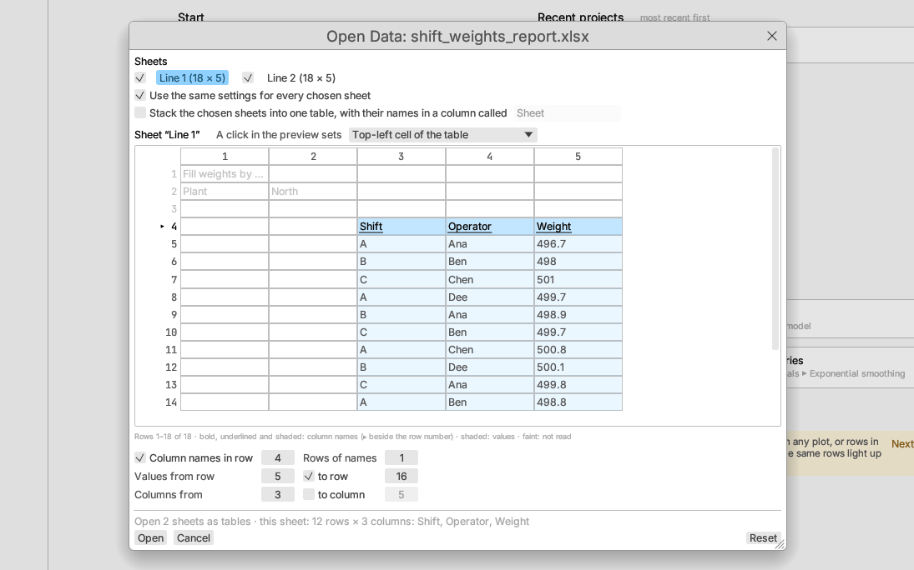

# The Open Data dialog

Text files (`.csv`, `.tsv`, `.tab`, `.txt`, `.dat`), spreadsheet workbooks,
tables read from a web page or web text, and **File ▸ New table from
clipboard** all pass through the **Open Data** dialog before they become a
table. Files often do not start with the column names in their first row:
a report saved from another program may have a title, a few lines about
the data, a blank row, and only then the table, which may not start in the
first column either. The dialog shows the cells as they are and lets you
say where the table sits.

## The preview

The preview shows the cells with their row numbers down the left and column
numbers across the top (the first 200 rows; tick **Show every row** for
more). It marks what each choice takes in:

- **column names**: bold, underlined, strongly shaded, and a ▸ beside the
  row number;
- **values**: lightly shaded;
- cells that are **not read**: faint text, no shading.

Point at a cell to see its full text.

A click in the preview sets what **A click in the preview sets** names:

| Choice | A click on a cell… |
|---|---|
| Top-left cell of the table (the default) | makes its row the row of names and its column the first column; the values start below the names |
| Row of column names | makes its row the row of names |
| First row of values / Last row of values | makes its row the first or last row read as values |
| First column / Last column | makes its column the first or last column read |

## Where the table sits

The numbers under the preview say the same as the shading and can be typed
or dragged:

- **Column names in row** (untick when the file has no names: the columns
  are then called `Column 1`, `Column 2`, …) and **Rows of names**. With
  two or more rows of names, each column's name joins its cells with a
  space; a blank cell in an upper row takes the text to its left, as a
  heading merged across several columns does, so `Temperature` above `Min`
  and `Max` gives `Temperature Min` and `Temperature Max`.
- **Values from row**, and **to row** when the table stops before the end
  of the sheet (for example above a footnote). Blank rows among the values
  are skipped.
- **Columns from**, and **to column** to stop before the last column.
  Columns that are blank in every row read are left out.

Blank names become `Column N` and a repeated name gets ` (2)`, ` (3)`, …,
as described in [Documents, files and projects](documents.md#opening-data);
the import note lists any name that was changed.

The line above **Open** says what the choices give for the sheet on show,
for example *12 rows × 3 columns: Shift, Operator, Weight*. **Open** (or
Enter) opens the table, **Cancel** (or Escape) opens nothing, and **Reset**
goes back to the detected settings.

## What is detected

The dialog opens with settings worked out from the cells, as a starting
point:

- The table is the largest run of rows without a blank row. A run of
  similar width above or below it, over the same columns, joins it (a table
  with a blank row in the middle stays whole); a narrow run, such as a title
  or a footnote, or a heading block off to the side, does not.
- The first row of the table that is at least half as wide as the table
  holds the names, unless it holds numbers and no column has text in it
  above numbers further down (then the file has no names).
- The first and last columns are those the table's rows use.

## Text files

For text, the dialog also shows:

- **Columns separated by**: *Detect* (the choice shown in brackets, such as
  *Detect (semicolon)*), or comma, tab, semicolon, vertical bar or space.
  The separator is detected for every text file, `.csv` included, except
  that `.tsv` and `.tab` files use tabs. Pasted text with a tab in it is
  split at tabs.
- **Decimal mark**: *Point 1.5* or *Comma 1,5*; the one found in the file
  is marked *(detected)*. With a decimal comma, a column whose every value
  reads that way becomes numbers: `1,5` is 1.5 and `1.234,5` is 1234.5
  (points may only separate groups of three digits). A column with any
  other value, such as a date `03.04.2026`, is left as it is.
- **Also read as missing**: texts, separated by commas, that stand for a
  missing value in this file (such as `-`, `n.a.` or `999`), on top of the
  standard markers listed under [Opening data](documents.md#opening-data).

Files that are not UTF-8 are still read: UTF-16 text (what spreadsheets
save as "Unicode text") is recognised by its byte-order mark or by the zero
bytes between its letters, and anything else is read as Windows-1252
(Western European), with a note saying so.

If rows have fewer fields than the widest row, the missing fields are left
blank and a note says how many rows were short.

## Workbooks

A workbook lists its sheets at the top, each with its size. Tick the sheets
to open (empty sheets cannot be ticked) and click a sheet's name to show it
in the preview.

- **Use the same settings for every chosen sheet** (on when the sheets look
  alike): a change applies to every ticked sheet. Untick it to set each
  sheet on its own.
- **Stack the chosen sheets into one table**: the sheets' rows are put one
  under another, with a first column (called *Sheet* unless you name it)
  holding each row's sheet name. Columns are matched by name; a sheet
  without a column leaves it blank. Values are typed after stacking, so a
  column is numeric only when it holds numbers in every sheet.

Without stacking, each ticked sheet becomes a table, the tables of one
workbook together in one project named after the file.

## Opening without the dialog

**File ▸ Settings… ▸ Open files directly when the table starts in the
top-left cell** (off by default) skips the dialog for files whose detected
table has its names in row 1, its values from row 2 to the end, every
column, and no decimal comma. Other files still show the dialog.

Scripts open files without the dialog: `open_table(path)` uses the
detected settings, and `open_table(path, #{…})` takes the dialog's choices
as a map (see [Scripting and recording](../reference/scripting.md)). A recorded script
writes the map when the choices differ from the detected ones.

## A table already open

**Data ▸ Rows ▸ Use row as column names** fixes a table that was opened with
its names as a row of values: the row of the cell cursor (or the one
selected row) becomes the column names and is removed, and text columns
whose remaining values are all numbers or all dates become number or date
columns. It is one step that **Undo** reverses.

## Web tables

**File ▸ Import from the web…** shows the dialog for a table on a web page
and for delimited text (JSON needs no choices). The choices are kept with
the table, in its project too, so **Data ▸ Refresh from source** reads the
same rows and columns again; when the choices were left as detected, a
refresh detects them again.
