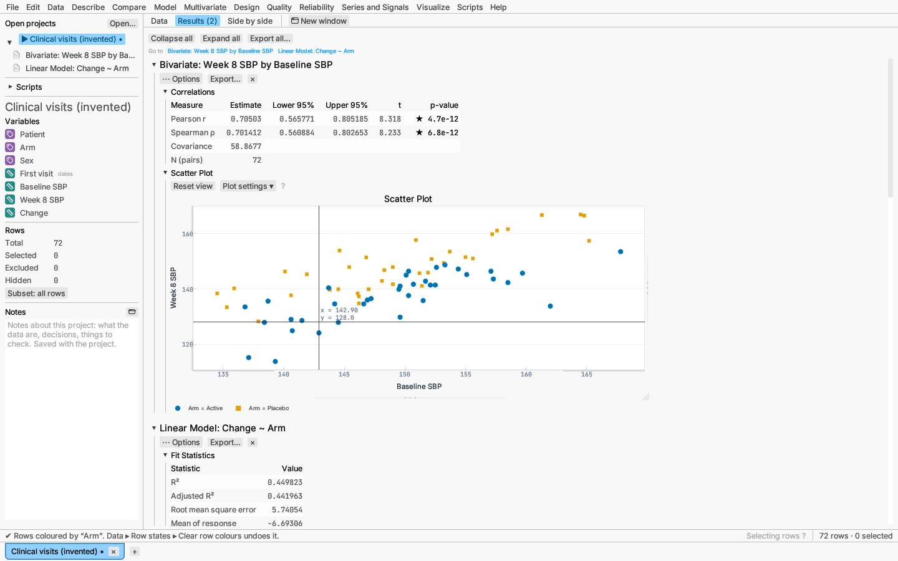
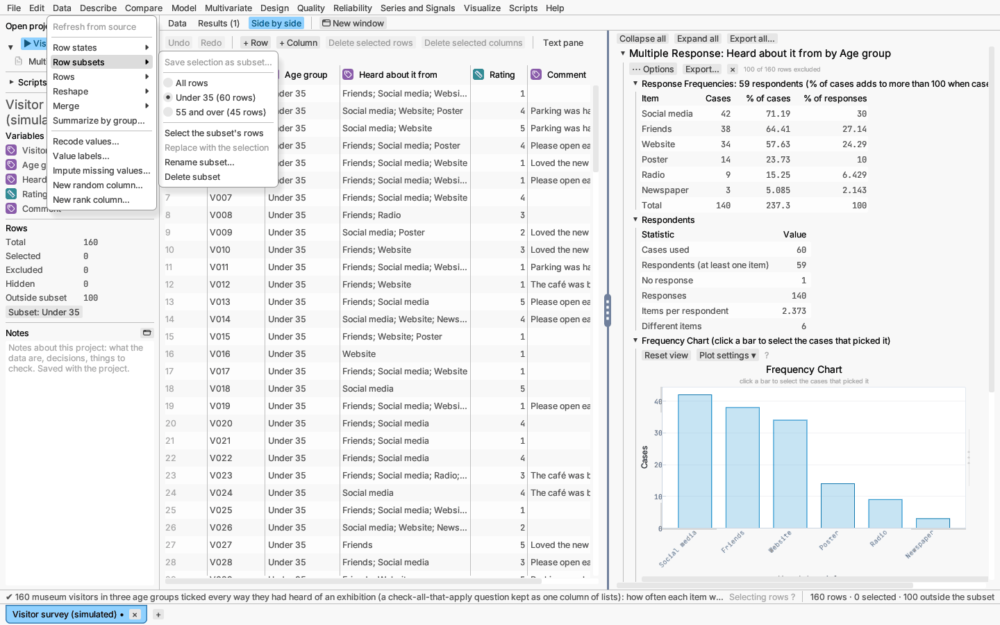

# Row states: select, exclude, hide

Every row has a state shared by the whole document: the grid, every plot and
every report. This is linked brushing: select rows anywhere and they are
highlighted everywhere.

| State | What it does |
|---|---|
| **Selected** | Highlighted in the grid and ringed in every plot. Selection does not change any result. |
| **Excluded** | Left out of every analysis; reports re-run without it. Plots draw excluded rows hollow and gray, with a key entry. The grid marks them ×. |
| **Hidden** | Not drawn in plots, but still analysed. The grid marks them ◌. |
| **Colour and marker** | A display colour and marker shape for the row's points. |

The sidebar's *Rows* section counts total, selected, excluded and hidden
rows, and so does the right end of the status bar.

## Selecting

- In a plot, drag a box or click a point. For a freehand outline, turn on
  **Lasso selection** in a report scatter plot's right-click menu (the graph
  canvas has its own lasso button).
- In the grid, click a row number to select its row, Shift-click another
  row number to select every row between the two, or drag down the row
  numbers (see [Editing the data grid](editing.md)). Clicking a data cell
  only moves the cell cursor. Right-click a row number to select only that
  row.
- In plots, Shift adds to the selection, ⌘/Ctrl toggles, ⌥/Alt removes. On
  the row numbers, ⌘/Ctrl and ⌥/Alt do the same, and Shift selects a run.
- In a decision tree diagram, click a node to select its training rows.
- Data ▸ Row states: Select all rows, Clear selection, Invert selection,
  Select excluded rows.
- Edit ▸ Find…: **Select matching rows** selects every row containing some
  text (see [Editing the data grid](editing.md#finding-and-replacing)).
- In a report, the faint "N of M rows excluded" note under the title selects
  the excluded rows when clicked.

## Excluding and hiding

From Data ▸ Row states (or a row's right-click menu): Exclude selected rows
from analyses, Include selected rows in analyses, Include all rows in
analyses; Hide selected rows in plots, Show
selected rows in plots, Show all rows in plots.

## Colours and markers from a column

**Data ▸ Row states ▸ Colour and marker by column…** (also *Colour and
marker rows by this column…* in a column heading's right-click menu) gives
every row a colour from its value in one column:

- A **categorical** column (nominal or ordinal, or any text column) gives
  each level its own colour *and* marker shape, so the groups stay apart in
  print and for colour-blind readers. Levels take the seven palette colours
  and eight shapes in turn, giving 56 distinct pairs. Levels are ordered
  naturally by their names (value labels where the column has them).
- A **continuous** column gives a colour ramp from its smallest to its
  largest value, with the default circle marker. Rows with no value keep no
  colour.

The dialog previews each level's swatch with its row count (or the ramp
with its two ends) before you press **Apply**.

Every report scatter plot and every point layer on the graph canvas that has
no colour, shape or overlay grouping of its own then draws each row in its
colour and marker. The plot's key names the column and each level the
plotted rows show ("Arm = Placebo"), or the ramp's two ends. A plot with its
own grouping keeps it.

**Data ▸ Row states ▸ Clear row colours and markers** removes every row's
colour and marker. Colours given by a script (`t.color_rows`) are cleared
too.

Row states, colours and markers are saved in projects, can be set from
scripts, and are recorded when you record actions.

## Row subsets

A row subset is a named set of rows that you can switch to and back from,
such as one site of a study, the runs before a process change, or the rows
of one customer type. One subset at a time can be *active*: rows outside it
are then left out of every report, plot, dashboard tile and script exactly
as excluded rows are, and every report re-runs at once. Switching back to
**All rows** brings them all back.

Open **Data ▸ Row subsets**, or click the *Subset* line under the row
counts in the sidebar (it names the active subset, or says *all rows*):

- **Save selection as subset…** names the selected rows. A name already in
  use replaces that subset's rows. A table keeps up to 64 subsets; saving
  does not switch to the new one.
- **All rows** and one entry per saved subset (with its row count) choose
  the active subset.
- With a subset active: **Select the subset's rows**, **Replace with the
  selection** (same name, the selected rows instead), **Rename subset…** and
  **Delete subset** (analyses use all rows again).

Rows outside the active subset show ⊘ in the grid and their text is faded;
the sidebar and status bar count them apart (*Outside subset*). A subset is kept apart from
your own exclusions and hidden rows: excluding a row while a subset is
active, then switching to All rows, leaves exactly the rows you excluded.

Subsets and the active one are saved in the project file (in each table's
`"rows"`: `"subsets"`, a list of names with their rows, and
`"active_subset"`), recorded when you record actions, and can be set from
scripts with `t.save_subset`, `t.use_subset` and `t.use_all_rows` (see
[Scripting](../reference/scripting.md)).
