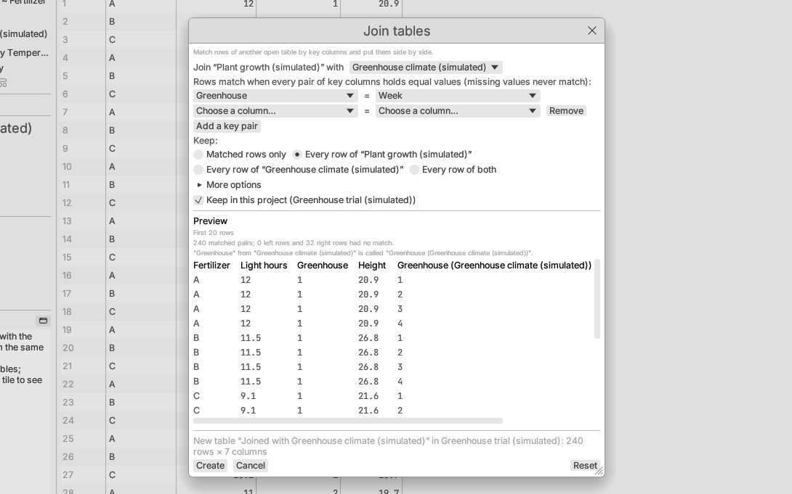

# Table operations

The **Data** menu reorganises tables. Every dialog previews its result before
you apply it, and the line at its foot names the table it will make and its
size. The main button says what it does: **Create** for a new table, **Sort**
or **Remove duplicates** when working on the table in place. See
[Using analysis dialogs](../getting-started/dialogs.md) for the parts every
dialog shares.

- **Sort** and **Remove duplicates** change the current table as one
  undoable edit (row states move with their rows), or optionally make a new
  table.
- The other operations open a **new table**. Where its rows map one-to-one
  to the source rows, it keeps their row states. It records how it was made,
  which shows in its tab's tooltip and is saved in the project.
- The new table gets a short name saying what it holds ("Summary by
  Fertilizer", "Fertilizer A only", "Stacked Employed, GNP"). With **Keep in
  this project** ticked (the default) it joins the source table's project and
  is listed under it; if the source is edited later, a **Source changed**
  banner offers to update it. Clear the box to open it as a separate
  project. See [Tables made from other
  tables](documents.md#tables-made-from-other-tables).

## Rows

- **Sort…** by one or more columns, each ascending or descending. Missing
  values sort last; text sorts in natural order (`item2` before `item10`).
- **Remove duplicates…** keeps the first of each set of repeated rows,
  comparing all columns or the ones you choose.
- **Subset and sample…** makes a table of all, selected, included or
  matching rows and the columns you choose. Optionally take a random sample,
  as a count or a fraction, stratified by columns (proportional allocation)
  and seeded so it can be repeated.
- **Use row as column names** makes the row of the cell cursor (or the one
  selected row) the column names, removes it, and types text columns again
  (see [The Open Data dialog](open-data.md#a-table-already-open)); undoable.

## Reshape

- **Stack columns…** (wide to long): chosen columns become a label column
  and a value column.
- **Unstack by label…** (long to wide): one column per level of a label
  column, rows matched by ID columns.
- **Transpose…**: rows become columns.
- **Distance matrix…**: the distance between every pair of included rows
  as a new table — an *Object* column naming the rows (by a label column you
  choose, or the row numbers) and one column per row, so row *i* of column
  *j* is the distance between rows *i* and *j*. Choose the distance
  (Euclidean, Manhattan, Gower, Jaccard, Bray–Curtis, Hamming or simple
  matching; see [Distance measures](../analyses/multivariate.md#distance-measures))
  and the columns compared; Euclidean and Manhattan can standardize them
  first. Gower accepts text and ordinal columns and missing values; the
  other distances leave out rows with a missing value. Up to 3000 rows. The
  table feeds Multivariate ▸ Principal coordinates…, Dimension reduction…
  and hierarchical Clustering… as a distance matrix.

## Merge

- **Combine rows…** appends the rows of other open tables, matching columns
  by name, with an optional column naming each row's source table.
- **Join…** matches rows of another table by key columns: inner, left,
  right or full outer. You can require the match to be many-to-one or
  one-to-one, and the join stops if the data break it. A missing key never
  matches anything, and a join in which no row matches (often the wrong key
  or an empty table) stops with a message instead of making a new table. If both tables have a column of the same name, the right
  table's copy gets its table's name in parentheses.

## Summarize by group

**Summarize by group…** (Data ▸ Summarize by group…, also in the Describe menu) makes one row per group with N, missing count, mean,
SD, minimum, maximum, median, quantiles and sum for each chosen column.
Tick the columns to summarize in the left-hand list (**Summarize**) and the
grouping columns in the right-hand list (**Group by**).

All of these operations are also available from scripts (see
[Scripting and recording](../reference/scripting.md)).
