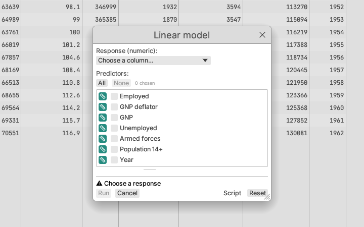

# Using analysis dialogs

Every analysis, design and table operation starts from a dialog. They all
work the same way.

## Choosing columns

- A drop-down list chooses one column for a role (a response, a grouping
  column). Each column shows its measurement-level icon; long lists have a
  filter box at the top. You can also drag a variable from the sidebar onto
  the list.
- Any list with more entries than it shows (a drop-down list, a check-box
  list, the script preview) fades out at its cut-off edge under a ▾ (▴ at
  the top once scrolled down), and its scroll bar is always drawn: scroll
  or drag the bar to see the rest. Scroll bars in reports, the data grid
  and the sidebar are always drawn too, wherever there is more to see.
- A check-box list chooses several columns. Type in **Filter columns** to
  narrow a long list; **All** and **None** select or clear every column
  listed. Shift-click a box to give every box between it and the one you
  clicked before the same state. Drag a variable from the sidebar onto the
  list to add it. Drag the short bar under the list to make it taller.
- Where two lists sit side by side, the columns being analysed or
  summarized (responses, measures) are on the left and the columns that
  group or explain them (grouping columns, factors, classifications) on the
  right: Summarize by group, Multi-way table, Factorial analysis, Augment
  design, Signal-to-noise analysis and Declare table as design all follow
  this order.
- Columns selected in the data grid (click their headings) are filled in
  when you open a dialog, in its main role: the predictors of a model, the
  columns of a distribution report, X and Y of a bivariate analysis.

## The foot of the dialog

- **Run** (analyses) or **Create** (designs and new tables) does the work.
  While something is missing, the button is unavailable and the line above it
  says what to do, marked with ⚠: "Choose a response", "Choose at least one
  predictor", "Group and data column must differ". Hovering the button shows
  the same text.
- When the dialog is ready, the line says what it will do and on how many
  rows, for example "Linear model of Employed on 2 effects · 46 of 48 rows
  (2 excluded)".
- **Cancel** closes the dialog. **Reset** clears every choice and starts
  again from the defaults.
- **Script** (analyses) shows the script call the dialog's settings make,
  updated as you change them, with **Copy script** to put it on the
  clipboard for the Script window (see [Scripting](../reference/scripting.md)).
  It stays on for other dialogs until you turn it off.
- **Enter** runs and **Escape** cancels. While you are typing in a field,
  Enter only finishes the field; press **⌘/Ctrl+Enter** to run from there.

## More options

Settings most analyses leave at their defaults (method variants, tuning
values, seeds, tolerances and explanatory notes) are in a **More options**
section that starts closed. Opening it changes nothing; the defaults are
the same either way. A random seed can be any whole number from 0 to
2⁵³ − 1 (9 007 199 254 740 991), the largest a project file stores exactly;
a larger seed in a project or script is read as that largest one.

## Moving and resizing

Dialogs open in the middle of the window. Drag a dialog's title bar to move
it out of the way of the data, and drag its edges to make it larger. It
reopens where you left it.

## Remembered settings

A dialog remembers what you chose last, for each open document, while the
app runs: reopening Linear model after a fit shows the same response and
predictors, ready to change one thing. A dialog still open when you switch to
another document closes, and its settings are kept for the document it was
open on: reopen it there to carry on. Adding columns (a formula or a saved
prediction) keeps the remembered settings; inserting, deleting or moving
columns forgets them, as does closing the document.

## Editing an analysis

Choose **Edit analysis…** at the top of a report's **⋯ Options** menu (or
right-click the report's heading). The report's dialog opens with its
columns and settings filled in. Change what you need, then:

- **Update** replaces the report in place. It keeps its position, its display
  options (the sections you turned on or off) and each plot's size and axis
  settings; plot views re-fit to the new results.
- **Run as new** keeps the report and adds a second one with the new
  settings.

Graphs are changed on their canvas, so they do not offer Edit analysis….
Reports opened from a project file or a script can be edited too: the
dialog is filled from the request the project stores.
