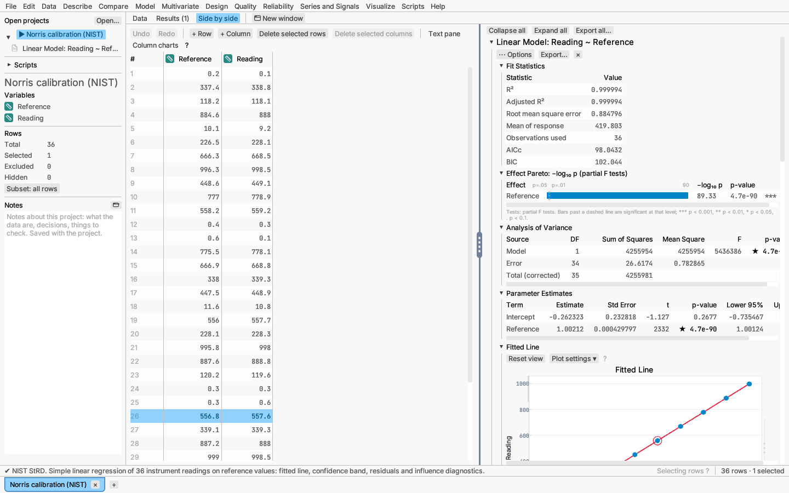

# Your first analysis

This walk-through fits a regression to a NIST reference dataset and follows
an observation between plots.

1. **Open the data.** Choose File ▸ Open sample data ▸ Models ▸
   *Norris calibration (NIST)*. The table opens in a new document tab.
2. **Look at the columns.** The sidebar lists `Reference` and `Reading`,
   both continuous (ruler icon). The sample also opens with a ready-made
   report; you can close it with **Remove report** and fit your own.
3. **Fit a model.** Choose Model ▸ Linear model…, choose `Reading` as the
   response, tick `Reference` in the predictor list and click **Run**.
   The Results tab opens with the report.
4. **Read the report.** Fit statistics (R², RMSE and others), the Effect
   Pareto, parameter estimates and effect tests come first, then a fitted
   line plot. Click a section heading to collapse or expand it.
5. **Add a diagnostic.** Open the report's **⋯ Options** menu (or right-click
   a section heading) and add the residual plot.
6. **Brush.** Drag a box around the largest residual. The point is ringed in
   the residual plot, in the fitted line plot and in the data grid (switch to
   **Side by side** to see the grid next to the report).
7. **Exclude it.** Choose Data ▸ Row states ▸ Exclude selected rows from analyses. The report re-runs
   without that row; excluded rows are drawn hollow and gray.
8. **Save your work.** Right-click the document in the sidebar and save it as
   a project (`.acraft`). Reopening the project restores the data, the
   exclusion and the report exactly.

Next, read [Using analysis dialogs](dialogs.md), [Reading a report](../reports/reports.md) and
[Working with plots](../reports/plots.md), which apply to every analysis.
