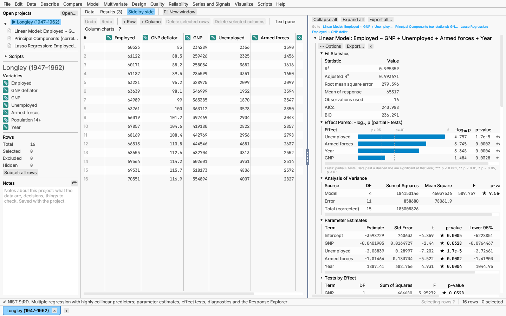
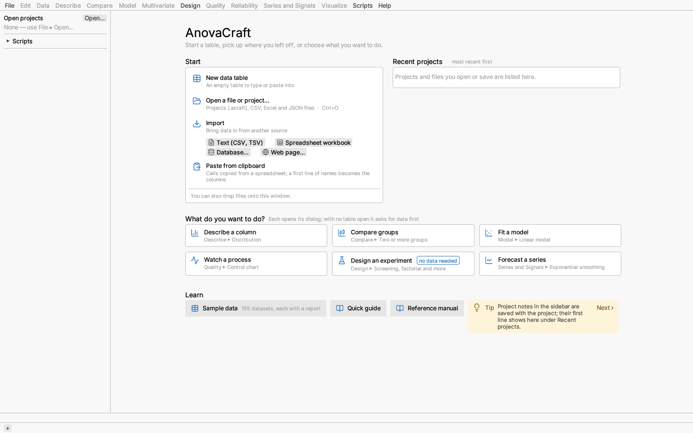

# A tour of the window

The window has five parts.

**Menu bar.** File, Edit, Data, Describe, Compare, Model, Multivariate,
Design, Quality, Reliability, Series and Signals, Visualize, Scripts and Help. Every menu is
there even before any data is open; menus that need data say "Open a dataset
first" until a table is open, and Design works without one, because it
creates a new table. **Scripts** holds the Script window, Open script…, Run
script over a folder… and action recording (see [Scripting and recording](../reference/scripting.md)).
**Help** opens the Quick Guide or this Reference Manual in your browser, lists every keyboard shortcut,
and shows the version under About AnovaCraft.

**Left sidebar.**

- *Open projects* lists every open table, grouped by project when a project
  holds several. Click one to switch to it; right-click it to save, export
  or close it. A • after the name means it has unsaved changes.
- *Scripts* (click the heading to open it) lists the scripts in your scripts
  folder and those kept in the active project; click one to open it, or
  right-click to run it.
- *Variables* lists the active table's columns. Each shows its measurement
  level as an icon with a tooltip (a ruler for continuous, a tag for nominal,
  a numbered list for ordinal) and its data type. Formula columns are marked
  ƒ. Click a variable to select its column in the grid and scroll to it;
  right-click it for the same menu as the column's heading; drag it onto a
  graph canvas shelf. When a table has more than eight columns, a **Filter**
  box beside the heading shows only the variables whose names contain what
  you type.
- *Rows* counts the total, selected, excluded and hidden rows.
- *Notes* holds free-text notes about the project: what the data are,
  decisions, things to check. They are saved in the project file, and the
  first line shows under Recent projects on the start page. The notes are
  always those of the project you are working in, so switching to a table of
  another project switches to its notes. The small window button beside the
  heading moves the notes into a window of their own (which also follows the
  project you work in); **Back to sidebar**, or closing that window, puts
  them back.

**Getting-started tips.** The first time you open a dataset, a few short
tips sit under the workspace tabs. **Got it** hides them for good (File ▸
Settings… can show them again).

**Workspace tabs.** Above the center area, choose **Data** (the grid),
**Results** (the reports for this table, with their count) or **Side by
side** (the grid with the reports in a pane beside it, useful for brushing).
⌘1, ⌘2 and ⌘3 (Ctrl+1/2/3 on Windows and Linux) switch between them.
**New window**, beside them, moves the grid (or the results) into a window
of its own, for example onto a second screen; see
[Views in windows of their own](../data/documents.md#views-in-windows-of-their-own).

**Document tabs.** Along the bottom edge, one tab per open document. The ×
closes it (you are asked first if it has unsaved changes), + opens another
file, and right-click offers the same actions as the sidebar. A • after a
tab's name, and "(edited)" in the window title, mean the document has
unsaved changes.

**Status bar.** Shows the result of the last action (shortened with "…"
when it is longer than the space beside the row counts), ⏺ Recording while
actions are being recorded, and **Undo remove** for 30 seconds after a
report is removed. Hover "Selecting rows ?" for a reminder of the selection
gestures: click or drag in a plot or on the grid's row numbers to select
rows; Shift adds (on row numbers, the run of rows between two clicks),
⌘/Ctrl toggles, ⌥/Alt removes. The right end shows the cell at the grid's
cursor with its column and value, and how many rows are selected, excluded
and hidden.

## The start page

The app starts on the start page, and shows it again whenever nothing is
open (opening a file from Finder or the command line skips it).

- **Start**: **New data table** (an empty table to type or paste into),
  **Open a file or project…**, **Import** from delimited text, a spreadsheet
  workbook, a database or a web address, and **Paste from clipboard** (cells
  copied from a spreadsheet; a first line of names becomes the column names).
  You can also drop files onto the window.
- **Recent projects**, most recent first: each project with when you last
  opened or saved it, its tables and the first line of its notes ("No notes"
  when it has none); a plain data file shows its rows and columns. Click one
  to open it. **Show all recent** lists the rest.
- **What do you want to do?**: six common tasks, each naming the menu item it
  opens (Describe ▸ Distribution, Compare ▸ Two or more groups, Model ▸
  Linear model, Quality ▸ Control chart, the Design menu's designs, and Time
  Series ▸ Exponential smoothing). Designing an experiment needs no data;
  the others, chosen with no table open, show an **Open data for …** box in
  front of the start page: **Choose a file…**, **Start an empty table** or
  one of the samples listed there, after which the task's dialog opens on
  that table. **Cancel** (or Escape) closes the box and opens nothing.
- **Learn**: **Sample data** lists every sample by topic (see
  [Sample data](sample-data.md)), **Quick guide** and **Reference
  manual** open the plain-language guide or this manual as a PDF, and a tip with **Next** for another.

Help ▸ Quick guide and Help ▸ Reference manual open the two manuals. Both
are built into the app as PDFs: AnovaCraft writes the one you ask for to the
`manuals` folder beside its settings file (in `~/Library/Application
Support/Statistical Engine` on macOS, `%APPDATA%\Statistical Engine` on
Windows, `~/.config/statistical-engine` on Linux) and opens it in the system's
PDF viewer, so they work offline and always describe the version you are
running. Each PDF has a linked contents page and a bookmark for every
chapter; links into the other manual go to its pages on GitHub. A newer
version of the app replaces the old copies the first time you open them.
Help ▸ About AnovaCraft also links to both, and to the manuals' pages online.
It names AnovaCraft's licence (the Apache License 2.0 or the MIT licence, at
your option; `COPYRIGHT`, `LICENSE-APACHE` and `LICENSE-MIT` in the
repository), and its **Open-source licences** button shows the third-party
notices built into the app: the copyright notices and licence texts of the
bundled fonts (Inter, JetBrains Mono, Liberation Sans and Serif, DejaVu Sans
and egui's default fonts), the Lucide icons, the VADER sentiment lexicon and
every Rust library compiled into the app. The same text is
`THIRD-PARTY-NOTICES.txt` in the repository, in the macOS app bundle's
Resources folder and beside the Windows program; `anovacraft-run --licences`
prints it, and Publish as web app… writes it into the published folder.

Help ▸ Keyboard shortcuts lists every shortcut. The most used are ⌘O open,
⌘N new table, ⌘S save, ⇧⌘S save as, ⌘W close, ⌘Z undo, ⌘F find, and ⌘1/2/3
for the workspace views (Ctrl instead of ⌘ on Windows and Linux).
