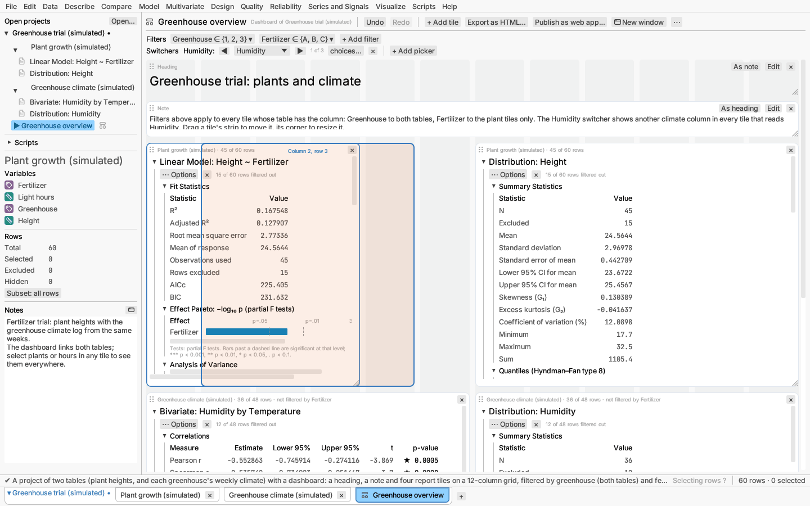
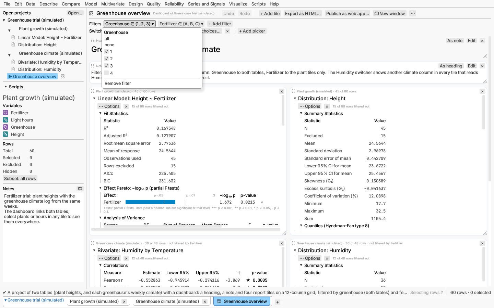
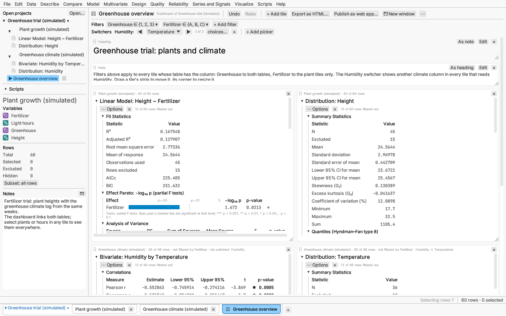
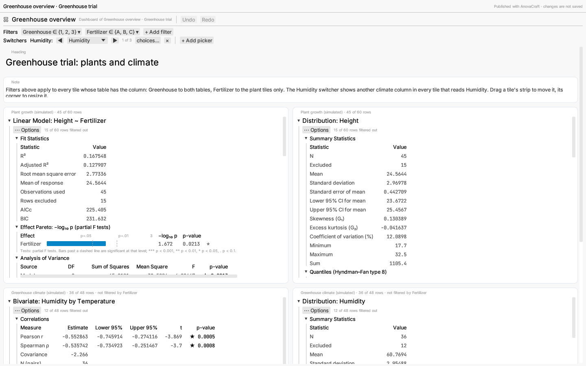
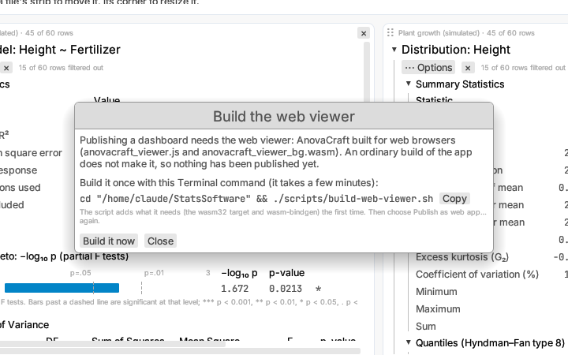

# Dashboards

A dashboard arranges reports and notes from a project's tables on one page,
with filters that narrow every report on it at once. Use one to put the
results you check most often side by side, or to show a summary to someone
else, either in the application or exported as a web page.

To try one, open **File ▸ Open sample data ▸ Projects ▸ Greenhouse trial
(simulated)**. The project has two tables, plant heights and each
greenhouse's weekly climate, and opens on its dashboard, "Greenhouse
overview".

## Where dashboards live

A dashboard belongs to a project and uses only that project's tables. It is
listed in the sidebar under the project's tables (with a small grid symbol),
and has a tab after the project's tables' tabs along the bottom of the
window. Click either to show the dashboard in the main window; click a table
to go back to it, or press ⌘W / Ctrl+W while the dashboard is shown.
Right-click a dashboard's entry or tab to show it, open it in a window of
its own, export it as HTML or remove it from the project.

Removing a dashboard asks first (**Keep** is the default, so Enter or
Escape leaves it alone). After **Remove**, **Edit ▸ Undo remove dashboard**
puts it back where it was until you edit data again; save the project to
make the removal permanent. Closing a table that is the last one some
dashboard uses also asks, naming the dashboards that would be left empty.

To make one, choose **File ▸ New dashboard** or **New dashboard** in the
project's right-click menu, or use **Add to dashboard ▸ New dashboard** in a
report's ⋯ Options menu, which starts the new dashboard with a copy of that
report. New dashboards are named "Dashboard", "Dashboard 2" and so on;
rename one from the **⋯** menu at the end of its toolbar.

Dashboards are saved in the project file, with their tiles, filters,
column pickers and name, which dashboard was shown and whether it was in a window of its own.
Save the project to keep them.

## Tiles

The page is a grid twelve columns wide. Each item on it is a **tile**:

- **A report tile** holds a copy of a report bound to one of the project's
  tables. It is made by **Add to dashboard** in the report's ⋯ Options
  menu (or the menu you get by right-clicking its title), or by **+ Add
  tile ▸ From "table"** in the dashboard's toolbar, which lists that table's
  reports and offers an empty graph canvas. The copy is the tile's own:
  changing its display options (sections shown, plot settings) changes the
  tile, not the report it came from, and the other way round. A new report
  tile is six columns wide and six rows tall, placed in the first free
  space.
- **A heading** is a line of large text across the dashboard; **a note** is
  a paragraph. Add them from **+ Add tile**. Double-click the text (or
  choose **Edit** in the tile's strip) to change it, then **Done**; **As
  heading** and **As note** switch between the two.

Each tile has a strip along its top. For a report tile it names the table,
how many of its rows the filters keep, and which filters do not apply to it.
Reports that are taller than their tile scroll inside it.

- **Move** a tile by dragging its strip (start on the dotted handle at its
  left end). Faint columns show the grid while you drag, and an outline
  shows where the tile will land; "Overlaps another tile" in red means it
  would cover another tile, and it stays where it was.
- **Resize** a tile by dragging the grip in its lower right corner. It snaps
  to whole columns and rows.
- **Remove** a tile with the × at the right end of its strip, or **Remove
  report** in the tile report's ⋯ Options menu.

Every change to a dashboard — adding, moving, resizing and removing tiles,
filters, column pickers, text, display options and its name — can be undone. Use **Undo** and
**Redo** in the dashboard's toolbar, ⌘Z / Ctrl+Z and ⌘⇧Z / Ctrl+Y while the
dashboard is shown, or **Edit ▸ Undo** and **Redo**, which act on the
dashboard while it is the last thing you used. Edits to the tables' data are
undone from the table, as before.

## Filters

The strip under the toolbar holds the dashboard's filters. **+ Add filter**
lists every column of the project's tables. A filter on a categorical column
keeps the levels you tick (with **all** and **none**); a filter on a
continuous column keeps a range between two sliders. Click a filter to change
it or to remove it. A change applies when you let go of the mouse button, so
dragging a slider is one edit that Undo puts back in one step.

Filters are matched to tables by column name:

- a filter applies to every tile whose table has a column of that name;
- a tile whose table has no such column is not filtered by it, and its strip
  says so ("not filtered by Fertilizer"; point at it for the reason).

In the sample, the Greenhouse filter applies to both tables and the
Fertilizer filter only to the plant tiles.

Filters never change the tables themselves. Each tile runs its report on a
copy of its table's rows with the rows outside the filters left out, so the
data grid, the table's own reports and its row counts are as they were. A
tile's report says how many rows the filters leave out ("15 of 60 rows
filtered out"), apart from any rows the table itself excludes, which it still
calls excluded.

## Column pickers

The strip under the filters holds the dashboard's **column pickers**. A
picker names a column and a list of columns to show instead of it; every
report tile that uses that column shows the chosen column in its place, in
whatever role the report uses it (a model's response, a distribution's
column, a graph's axis or colour). Use one to step a whole dashboard
through several measurements without editing each tile.

The sample has a picker on Humidity offering Temperature and Week. Click
**▶** to show the next column in the list, **◀** for the previous one, or
pick one from the list between them; "2 of 3" says where you are.

- **+ Add picker** lists every column of the project's tables. A new
  picker offers the project's other columns of the same type (numbers,
  text or dates) and shows its own column, so nothing changes until you
  pick another. **choices…** ticks the columns it offers.
- Pickers are matched to tiles by column name, like filters. A tile that
  does not use the picker's column is not affected. A tile that uses it
  but whose table has no column of the chosen name, or that already uses the
  chosen column in another role, is left as it is, and its strip says "not
  switched: Humidity". In the sample, choosing Temperature switches the
  humidity distribution but not the humidity-by-temperature plot, which
  already uses Temperature; choosing Week switches both.
- A switched tile's strip names the switch, for example "Humidity → Week".
- The tiles keep their own reports: choosing the picker's own column again
  shows every tile as it was. A display option you change in a switched tile
  is kept when you switch back.
- **×** removes the picker, and every tile shows its own column again.
  Each pick is one edit, so Undo steps back through them.

Pickers are separate from the column picker a single report can have
(its ⋯ Options ▸ Column picker): that one changes only its own report.

## Selecting rows

Selecting points in a tile's plot selects those rows in the tile's table, so
they are highlighted in its data grid, its own reports and every other tile
of that table. Tiles of other tables are not affected: brushing works within
one table. Rows the filters leave out are not drawn, so they cannot be
selected from the dashboard. Using a tile also makes its table the one the
menus, dialogs and the sidebar act on.

## A window of its own

**New window** in the dashboard's toolbar (or **Open in new window** in its
right-click menu) shows the dashboard in a window of its own, titled
"Greenhouse overview · Dashboard · AnovaCraft"; the main window goes back to
the project's tables. Undo, Redo and the other shortcuts work in that window
on the dashboard. **Back to main window**, the window's close button or ⌘W /
Ctrl+W in it shows the dashboard in the main window again. Clicking the
dashboard in the sidebar or its tab brings its window to the front. The
window and its place on screen are saved with the project.

## Exporting as a web page

**Export as HTML…** in the dashboard's toolbar (also **File ▸ Export
dashboard as HTML…** and the dashboard's right-click menu) saves the whole
dashboard as one self-contained web page:

- the dashboard's name, its project, its filters, the columns its pickers
  show in place of others (for example "columns switched: Humidity → Week")
  and the export date at the top;
- the tiles on the same twelve-column grid, at the same places and spans
  (each row grows to fit its tiles); on a narrow screen they are stacked in
  reading order;
- in each report tile, its title, its table and rows kept, and the sections
  open in the tile, with tables as HTML tables and plots as SVG drawings, as
  in [a report's own export](exporting.md#the-web-page);
- headings and notes as text.

## Publishing as a web app

**Publish as web app…** in the dashboard's toolbar writes a folder that shows
the project's dashboards in a web browser, still interactive. Choose an
empty folder (or one published before, which is replaced); it gets:

- `index.html`, the page, titled with the dashboard and project names;
- `project.acraft`, the project with this dashboard first (its other
  dashboards follow; window layout and scripts are left out, and row
  selections cleared);
- `anovacraft_viewer.js` and `anovacraft_viewer_bg.wasm`, the viewer;
- `THIRD-PARTY-NOTICES.txt`, the licences of the open-source software the
  viewer is built with (the page links to it).

Put the folder on any web server (a static host such as GitHub Pages or an
intranet share) and open its address. Browsers do not run a page like this
from a file on disk, so to try it on your own computer run
`python3 -m http.server` in the folder and open <http://localhost:8000>.

In the browser the reports are computed again from the project's data, and
the dashboard works as in the app, except that nothing can be saved:

- filters and column pickers change, with Undo and Redo, and every tile
  recomputes;
- selecting points in a tile selects those rows in the tile's table, and
  a tile's ⋯ Options change what it shows;
- several dashboards show as choices in the top bar;
- tiles cannot be added, moved, resized, removed or edited, and commands
  that would add columns, reports or tables say so instead;
- reloading the page starts again from the published project.

The viewer files come from a WebAssembly build of AnovaCraft, which an
ordinary build of the app does not make. Until they are built, Publish as web
app… writes nothing and opens a **Build the web viewer** window instead. It
shows the Terminal command that builds them (`scripts/build-web-viewer.sh`,
see [Web build](../maintaining/web-build.md)) with a **Copy** button. In a
source checkout, **Build it now** runs that build in the background (a few
minutes the first time, which also installs the wasm32 target and
wasm-bindgen) and then asks for the folder to publish to.

To look at a
project the way the viewer shows it without a browser, run the app as
`app-gui --viewer project.acraft`.

## Limits

- A column picker on one tile's graph canvas, or a report's own column
  picker, changes only that tile; use the dashboard's column pickers to
  change every tile at once.
- A tile's report runs on its filtered rows, so its own tables can still
  count the rows the filters leave out as "excluded" (for example a
  distribution's "Excluded" statistic); the note under the report's title
  gives the filtered-out count.
- **Edit analysis…** and **Open in new window** are not offered in a tile's
  ⋯ Options menu: edit the table's report and add it again.
- Closing a table that has tiles on a dashboard takes those tiles off the
  dashboard and clears the dashboard's undo history.
