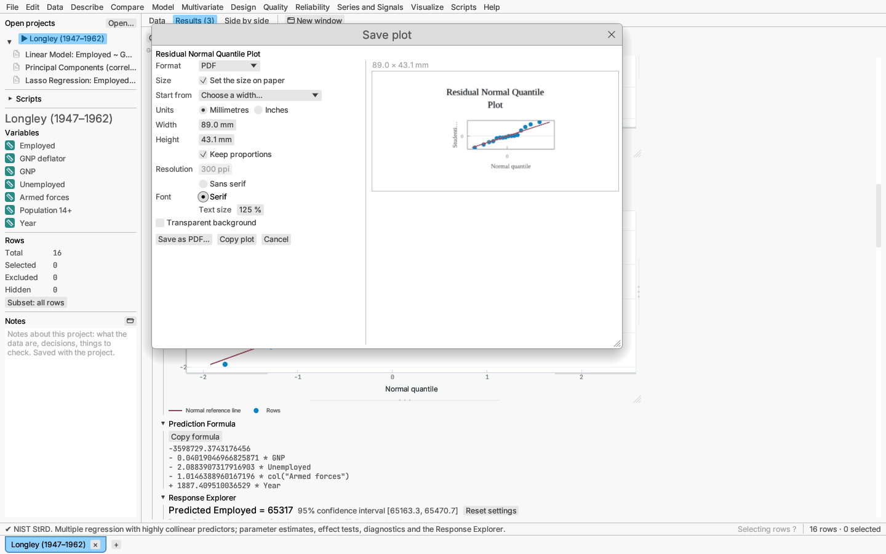
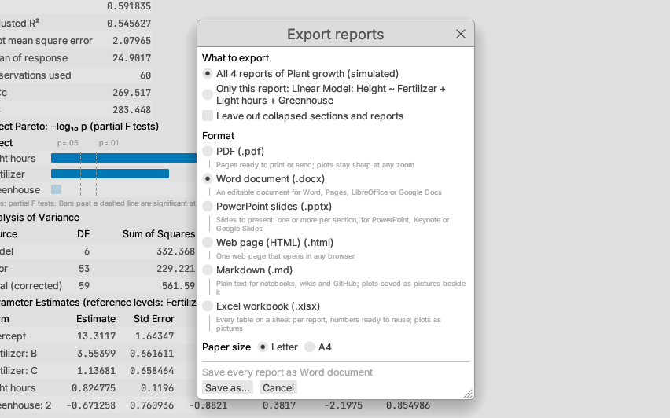

# Saving plots and results

## Plots

Right-click any plot, or its section heading, and choose **Save plot as
PNG/SVG/PDF/EPS…**.

- **PNG** is drawn from the plot itself at 300 pixels per inch, not taken as
  a screenshot, so it is sharp at any size.
- **SVG**, **PDF** and **EPS** are vector figures for publications.
- The figure keeps the plot's on-screen proportions and current axis ranges,
  is titled with the section name, keeps each group's colour and marker
  shape, and draws excluded rows hollow and gray with a key entry.

On a **Response Explorer**, the same menu saves every panel at its current
settings as one figure. On the **3-D surface profiler**, it saves the surface
at its current angle and settings, and the
[3-D scatter plot and 3-D surface of data](plots-3d.md) do the same. The graph
canvas offers the same items in its ⋯ Options menu (**Save as PNG…** and so
on).

### Copy plot

**Copy plot** puts the plot on the clipboard in three formats at once, so
the program you paste into takes the best one it reads:

| System | Formats offered |
|---|---|
| macOS | PDF (`com.adobe.pdf`; Keynote, Pages, Word and PowerPoint paste it as a vector picture), PNG, SVG |
| Windows | a bitmap (what most programs paste), PNG (the `PNG` format Office reads), SVG |
| Linux | `image/png`, `application/pdf`, `image/svg+xml` |

Windows programs paste vector pictures in the EMF format, which AnovaCraft
does not write, so there the plot pastes as a picture. If the clipboard
refuses the vector formats, the picture alone is copied and the message
under the report says so.

### Save plot as…

**Save plot as…** opens a dialog for one figure:

- **Format**: PNG, SVG, PDF or EPS.
- **Size**: off, the figure keeps the plot's on-screen proportions at about
  its on-screen size. **Set the size on paper** gives a width and height in
  millimetres or inches, with journal-column widths to start from (89, 120
  and 183 mm) and **Keep proportions** (changing one side changes the other).
  The figure is laid out at that size, so its text keeps its point size: a
  larger figure gives the data more room rather than larger text.
- **Resolution** (PNG): 36–1200 pixels per inch; the pixel size is shown.
- **Font**: **Sans serif** (Helvetica in PDF and EPS, Liberation Sans in
  PNG) or **Serif** (Times, Liberation Serif in PNG). SVG files name the font
  and its common stand-ins (Helvetica, Arial, Liberation Sans; Times New
  Roman, Times, Liberation Serif). **Text size** (50–300%) enlarges the text
  with the marks and lines: the figure is laid out on a page that much
  smaller and enlarged to the size asked for.
- **Transparent background** leaves the page clear instead of white (EPS
  has no transparency, so translucent marks are still blended with white).

The preview shows the figure as it will be written. **Save as …** writes the
file and closes the dialog; **Copy plot** copies the figure as set. Either
keeps the settings with the plot: the plot's **Save plot as PNG/SVG/PDF/EPS…**
items and **Copy plot** use them from then on, and they are saved with the
report (or the graph) in projects, dashboards, scripts and graph files.
Pictures that are kept as drawn (3-D views, trees, diagrams, word clouds)
are scaled to the size on paper, keep the settings for the session only, and
ignore the text size.

### Transparent background and Plot font

The same right-click menu has **Transparent background** (a check box) and
**Plot font** (Sans serif or Serif, and the text size), which change the
plot's figure settings without opening the dialog. On screen, the plot font
and text size apply to the plot's titles and tick labels (tick numbers stay
in the monospaced face, so digits line up).

**Add to figure page**, in the same menus, puts the plot on a page with
other plots, lettered A, B, C…, saved as one file at a chosen size in
millimetres or inches, pixel density, CMYK colour or transparent background
(see [Figure page](figure-page.md)).

## Report tables

Right-click any report table, or its section heading:

- **Copy table** puts the table on the clipboard as tab-separated text with
  its headings, ready to paste into a spreadsheet or document. Typographic
  minus signs become plain `-` and "—" (not applicable) becomes an empty
  cell, so spreadsheets read the numbers as numbers.
- **Save as data table** adds the table to the current project as a new
  table; **Save as data table in a new tab** opens it as a separate project
  instead. Columns whose cells are all numbers become numeric columns; the
  rest are text. The new table is a copy: it is not updated when the report
  changes.
- **Bootstrap this table…** re-runs the report on resamples of its rows and
  gives bootstrap standard errors, bias and intervals for chosen cells (see
  [Resampling](../analyses/resampling.md)). The report's ⋯ Options ▸
  Bootstrap a table lists every table of the report.

Numeric columns in report tables are right-aligned so their digits line up.

## Data and report columns

- Export a table as CSV, TSV, JSON or `.xlsx` (see
  [Documents, files and projects](../data/documents.md)).
- Report options menus save computed columns into the table: predicted
  values, residuals, prediction formulas, principal component scores,
  cluster numbers, Box–Cox transformed values and others.

## Whole reports as documents

Every report has an **Export…** button beside its ⋯ Options button (the same
item is in ⋯ Options ▸ **Export report…** and the report's right-click menu).
**File ▸ Export reports…** (⌘⇧E on a Mac, Ctrl+Shift+E elsewhere; also in the
table's right-click menu in the sidebar and on its tab) opens the same dialog
for every report of the table, as does **Export all…** at the top of the
Results pane, beside Collapse all and Expand all (so reports can be exported
with every report collapsed). The dialog opens in the window you asked from,
so a report or results pane in a window of its own gets it there.

In the **Export reports** dialog choose:

- **What to export:** all the table's reports in the order they are shown
  (the default), or, when the dialog was opened from a report, **Only this
  report**.
- **Leave out collapsed sections and reports:** off by default, so every
  section is exported whether it is open or collapsed on screen. Tick it to
  export only what is open: collapsed sections are skipped, and so are
  reports collapsed down to their title (unless you export only that
  report).
- **Format:**

  | Format | What you get |
  |---|---|
  | **PDF** (`.pdf`) | Pages ready to print or send. Plots are vector drawings that stay sharp at any zoom; text uses the bundled Inter and JetBrains Mono fonts, embedded. Bookmarks list every report and section, and each page is numbered. |
  | **Word document** (`.docx`) | An editable document for Word, Pages, LibreOffice or Google Docs. Report and section titles use Word's heading styles, so the navigation pane and a table of contents pick them up; table header rows repeat on every page; plots are pictures (Word 2016 and later draw them as vector graphics). |
  | **PowerPoint slides** (`.pptx`) | A 16:9 presentation for PowerPoint, Keynote or Google Slides: a title slide, a title slide for each report when there are several, then a slide for each plot, table or note, titled with its section. Long tables continue on further slides ("(continued)") and very wide ones are split into groups of columns. |
  | **Web page (HTML)** (`.html`) | One page that opens in any browser (see below). |
  | **Markdown** (`.md`) | Plain text for notebooks, wikis and GitHub, with tables as Markdown tables. Plots are saved as PNG pictures in a folder named after the file (`results_files` beside `results.md`). |
  | **Excel workbook** (`.xlsx`) | A sheet per report, its sections down the sheet. Cells that show a plain number are stored as numbers with the same decimals, so you can compute with them; plots are pictures. |

- **Paper size** (PDF and Word): Letter or A4.

Then **Save as…** asks where to save the file. The dialog remembers the
format and paper size you chose last.

What every format shares:

- It starts with the report's title (or "*table* reports"), the table, its row
  counts and the date it was exported.
- Every section is exported, collapsed or not, unless you tick **Leave out
  collapsed sections and reports**.
- Numbers are right-aligned so their digits line up.
- Plots are drawn as when saved with **Save plot as…**: titled, groups with
  their colours and marker shapes, excluded rows hollow and gray, on a white
  canvas.
- In PDF, tables too wide for the page are set smaller, then their text
  columns wrap, and if they are still too wide they are split into groups of
  columns, each starting with the first column. A table that runs onto the
  next page repeats its header row there.
- Interactive views that are not report sections (the Response Explorer and
  3-D views) are not included; save them with their own **Save plot as…**
  items.

### The web page

- Tables are real HTML tables, so they paste into a word processor or
  spreadsheet with their columns; numbers are in a monospace font.
- Plots are vector drawings (SVG) inside the page.
- The page follows the reader's light or dark appearance, using the
  application's colours.
- The page is self-contained: it loads nothing from the web. The bundled
  Inter and JetBrains Mono fonts (SIL Open Font License) are embedded in it,
  unless that would make the page larger than about 1.5 MB, in which case
  it uses the reader's system fonts.

A [dashboard](dashboards.md#exporting-as-a-web-page) exports the same way,
its tiles laid out on its grid (**Export as HTML…** in its toolbar, or
**File ▸ Export dashboard as HTML…**).

## Whole reports

Saving the document as a project keeps every report, and reopening it re-runs
them. Scripts can also save a report, or every report of a
table, in any of the formats above, sections as CSV or TSV, and plots as image files (see
[Scripting and recording](../reference/scripting.md)).
