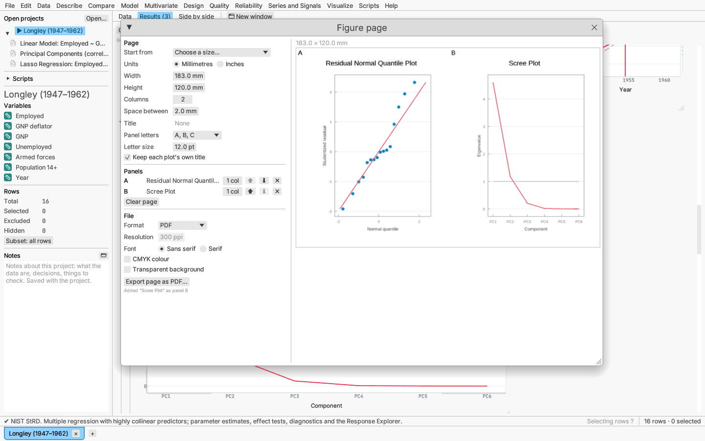

# Figure page

**Visualize ▸ Figure page…** gathers several plots on one page, letters
them A, B, C…, and saves the page as one PNG, SVG, PDF or EPS file at the
size a journal or poster asks for.

## Adding plots

Right-click any plot (or its section heading) and choose **Add to figure
page**, below the **Save plot as…** items. On a graph canvas the item is in
the report's **⋯ Options** menu, after the **Save as …** items. The figure
page window opens and the plot becomes the next panel.

- **Report plots, graph canvases and the Response Explorer** are kept as a
  copy of what they show when added (the same rows, groups and axis ranges)
  and are redrawn at the size of their panel whenever the page changes, so
  tick labels and titles keep their usual point size.
- **Other pictures** (3-D views, decision trees, cause-and-effect diagrams,
  word clouds) are kept as they were drawn and shrunk to fit their panel;
  hovering a panel's name in the list says which kind it is.

Later changes to the report do not reach the page: add the plot again and
remove the old panel. The page lasts while AnovaCraft is open.

## Page settings

| Setting | What it does |
|---|---|
| **Start from** | Sets the width to one journal column (89 mm), one and a half (120 mm) or two (183 mm), or the whole page to A4 or US Letter, upright or turned. |
| **Units** | Millimetres or inches for every length in the window. |
| **Width**, **Height** | The page size (1 inch to about 1.2 m a side). The default is 183 × 120 mm. |
| **Columns** | Columns of the grid (1–6). Panels fill it in reading order, in rows of equal height. |
| **Space between** | The gap between neighbouring panels. |
| **Title** | Optional text across the top of the page. |
| **Panel letters** | A, B, C · a, b, c · (A), (B), (C) · (a), (b), (c) · none, in bold in each panel's upper left corner; after Z come AA, AB, … |
| **Letter size** | In points (4–48; default 12). |
| **Keep each plot's own title** | Off leaves the letters to name the plots, as most journals ask (pictures kept as drawn keep theirs). |

The **Panels** list shows each panel's letter and name, and:

- the **columns it spans** (a panel two columns wide fills a row of a
  two-column page; one that does not fit in what is left of a row starts the
  next row);
- **⬆** and **⬇** to move it, and **✕** to take it off the page;
- **Clear page** removes every panel.

The preview on the right shows the page as it will be saved, with its size.

## Saving the page

| Setting | What it does |
|---|---|
| **Format** | PNG, SVG, PDF or EPS. |
| **Resolution** | Pixels per inch of a PNG page (72–1200; default 300), recorded in the file; the pixel size is shown beside it. Vector formats have no resolution. |
| **Font** | **Sans serif** (Helvetica in PDF and EPS, Liberation Sans in PNG) or **Serif** (Times, Liberation Serif in PNG) for every panel's text, the letters and the title. |
| **CMYK colour** | PDF and EPS only: every colour is written as cyan, magenta, yellow and black. The conversion is the simple complement rule without a colour profile (K = 1 − max(R, G, B), C = (1 − R − K)/(1 − K), likewise M and Y), so black is pure K; a print shop may still adjust colours to its press. PNG and SVG hold RGB colour only. |
| **Transparent background** | Leaves the page clear instead of white, for slides and posters with a coloured background (PNG, SVG, PDF). EPS has no transparency: its page is left unpainted, and translucent marks are blended with white. |

**Export page as …** asks where to save the file. Text in PDF and EPS is set
in the standard Helvetica or Times without embedding, as in single plots
(see [Saving plots and results](exporting.md)).
