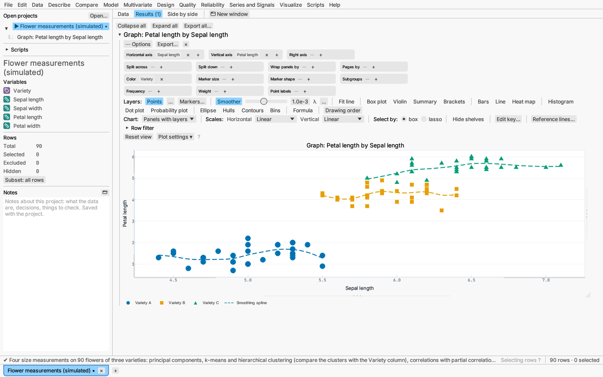
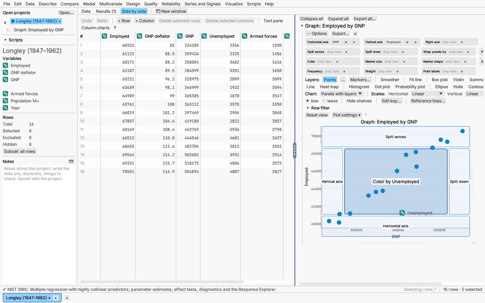
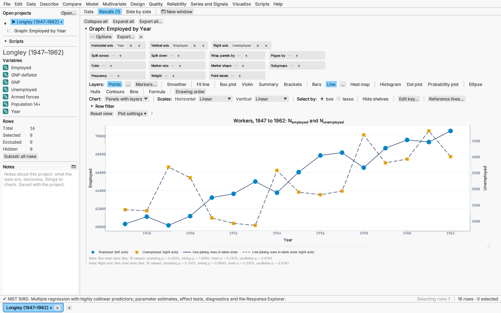
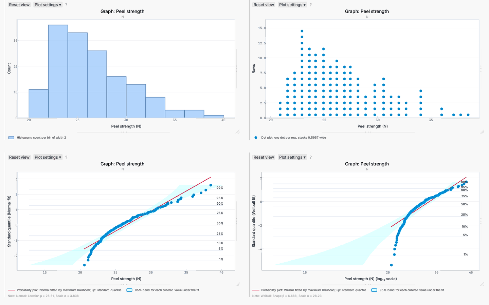
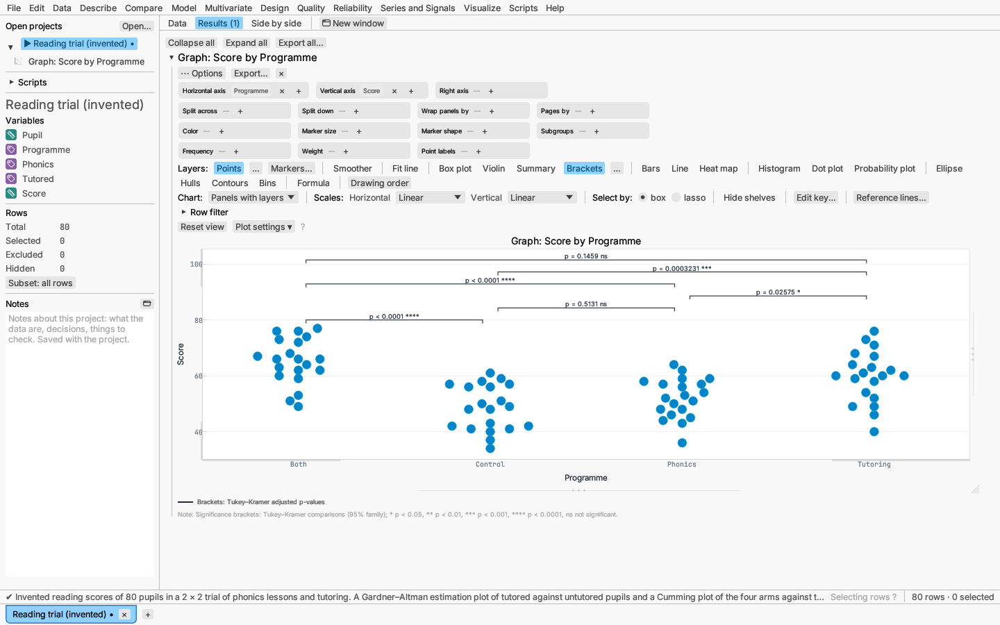
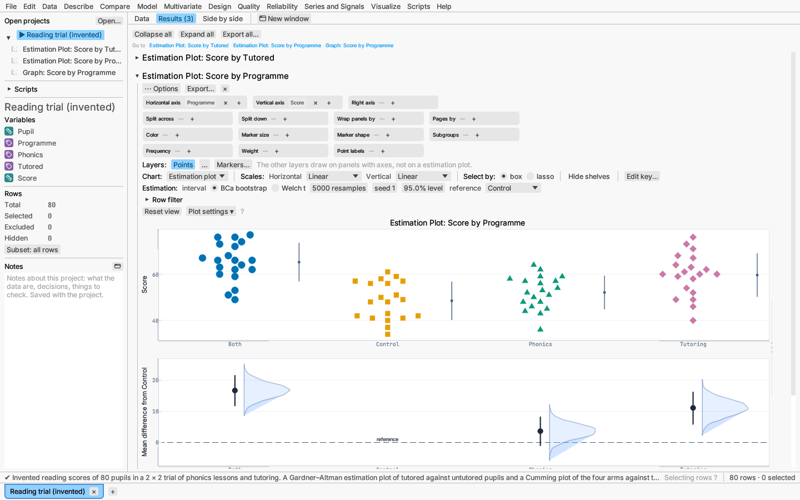
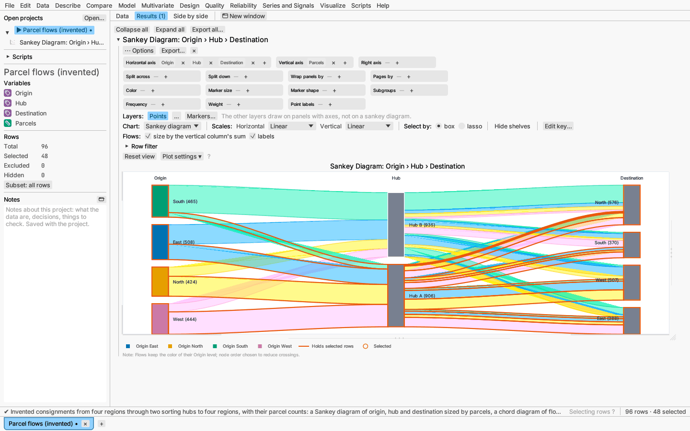
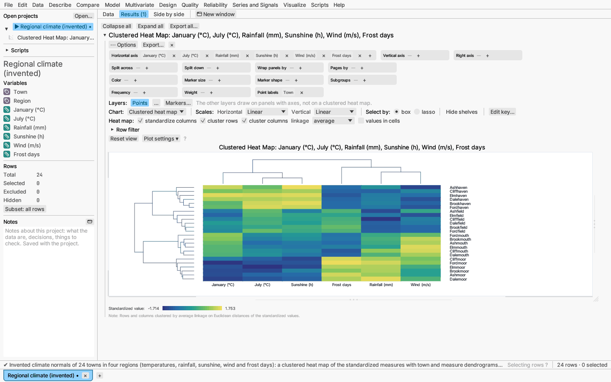
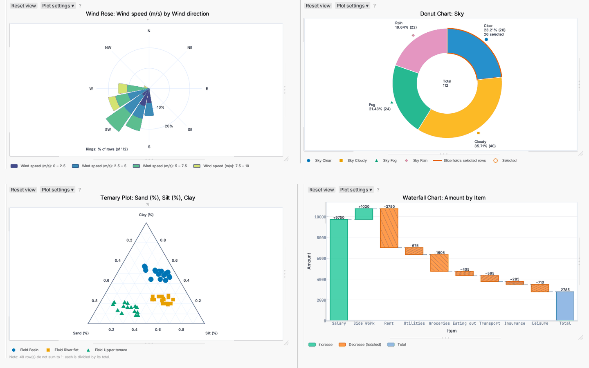
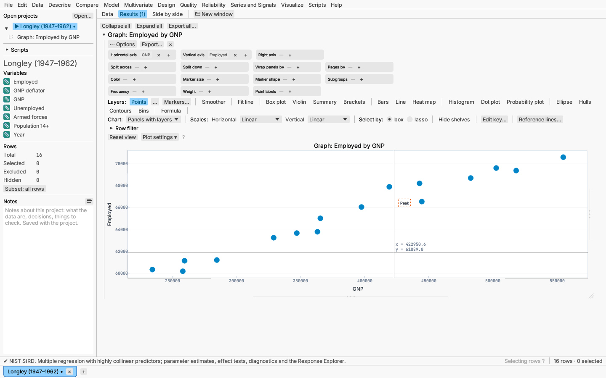

# Graph canvas

Visualize ▸ Graph canvas… builds a graph by dragging columns onto shelves and
stacking layers. It is the place for exploratory and presentation graphics
that are not tied to one analysis.

## Shelves

Drag a column from the list onto a shelf:

- **Axes:** X and Y, and the **Right axis** (see below).
- **Panel splits:** across, down, wrapped, or onto separate pages, to make
  linked small multiples.
- **Colour, size and shape** encodings, and **subgroups**.
- **Frequency** and **weight** columns. A frequency counts as that many
  repeated rows everywhere, including fit lines and smoothers.

A graph canvas opened in a window of its own (⋯ Options ▸ Open in new
window) lists the columns at the window's left, since columns cannot be
dragged from one window to another: drag them from there.

While you drag a column, **drop zones** appear over the panels: the bottom
edge for the horizontal axis, the left edge for the vertical axis, the top
edge to split across, the right edge to split down and the centre for
colour. The zone under the pointer is highlighted and says what it will do
("Color by Region"); let go there and the graph redraws. A column dropped
on an axis takes that axis's first place (on an empty axis it is added); a
chip dragged from a shelf moves, while a column from the variables list
stays on any other shelf it is on. The shelves remain the way to reach every
role, and to work from the keyboard.

A **column picker** lets you flip a shelf between several columns, and a
per-graph **row filter** (+ Add condition) limits the graph to matching
rows without changing the table's row states. The filter's form is the
filter panel described under
[Filtering a report and switching its column](reports.md#filtering-a-report-and-switching-its-column):
level lists, sliders and **Step through** a column one level (or one window
of values) at a time, by hand or with **▶ Play**. **Show beside the graph**
moves the filter into a panel left of the panels, so its sliders and
stepping controls sit next to the picture they change; **Move above the
graph** puts it back under the Row filter heading. Below the conditions,
**Show only matching rows**, **Analyse only matching rows** and **Select
matching rows** choose what happens to the other rows.

## Axis scales

Linear, log₁₀, ln, logit, square root and reciprocal. Date and time columns
get calendar axes. Changing a scale (or the chart form) re-fits the axes to
the data, dropping any ranges set by dragging an axis.

Panels showing the same column share its range, so dragging an axis in one
panel moves it in all of them. The ranges under **Plot settings** are those
of the first panel; typing new ones applies them to every panel, and
**Fit view to data** (like **Reset view**) re-fits them all.

## Right axis

Put one or more numeric columns on the **Right axis** shelf to draw them
against a second vertical axis on the right, with its own scale, ticks,
title and spine: for example temperature on the left and rainfall on the
right of the same time axis. The right-axis columns get the same layers as
the left (points, lines, fits…), and share the left axis's scale (linear,
log…). The key starts with which series uses which axis: the left column
"(left axis)", each right column "(right axis)", and every right-axis layer
entry ends in "(right axis)". Right-axis lines are dashed and their markers
differ in shape (hollow when the graph is split into groups by colour), so
the axes are told apart without relying on colour. A categorical column
cannot go on the right axis.

Select right-axis points by box, lasso or click as usual: they select the
same rows everywhere. The right axis is a ruler like the left one: drag near
an end to move that limit, elsewhere to shift it; double-click it to re-fit.
Right-click it (or use **Plot settings ▸ Right axis**) to type its title
and turn its tick marks and tick labels on or off. The right axis is drawn for the panels chart form
(not for treemaps, parallel coordinates and the other whole-graph forms);
its range is shared by every panel.

## Axis breaks

**Plot settings ▸ Horizontal axis / Vertical axis ▸ Axis breaks** leaves
stretches of a continuous axis out: tick **Leave out** and type where the
gap starts and ends, in data units. The axis then runs straight on from the
start of the gap to its end, with a short mark on the axis line showing
where. Use it when a few values lie far from the rest, so the bulk of the
data is not squashed. Values inside a gap are not drawn: markers there are
hidden (a note under the graph counts them), lines are cut at the gap, and
bands and areas stop at its edges. Fits and statistics are still computed
from all the data. A break needs a continuous axis (not categories or
dates), and applies in the scale shown (on a log axis, the gap is between
the logs of the two values). Saved figures draw the same gaps and marks.
Clearing **Leave out** removes every break and restores the axis unchanged.

- **Add a break** leaves another stretch out, starting as the middle third
  of the widest piece of the axis still shown; each further break has its
  own **from** and **to** fields and a **✕** that removes it. Breaks are
  kept in axis order, and overlapping ones act as one.
- **Segments and marks** lists the pieces of the axis between the breaks
  (*Below 10*, *150 to 900*, *Above 2000*, …). For each piece:
  - **Scale** — *Same as axis* (the default), or a scale of its own:
    linear, log (base 10 or natural), square root, logit or reciprocal, for
    example a log segment for small values below a linear one. Each piece
    is ticked and labelled on its own scale, and a note under the plot
    names the scales, since the labels alone would not say the spacing
    changes.
  - **Automatic share** — off, the piece takes a fixed **share** of the
    axis length in percent (a long tail squeezed into the top 20%, say);
    pieces left automatic share what is left equally. Shares are laid out
    over the extent of the data on that axis, and the lowest piece holding
    data keeps its own units, so dragging and zooming the axis still work.
    With no share and no scale set anywhere, each piece keeps the axis's
    own spacing.
  - **Break marks** — **Slashes** (two short parallel strokes, the
    default) or **Zigzag** (a short zigzag in the axis line), drawn on both
    spines of the plot.

A piece on another scale bends straight lines only at their vertices, so a
line joining two distant points across such a piece is drawn straight in
the broken drawing; fitted curves are sampled finely enough that this does
not show. Pieces with very different scales can mislead: Cleveland
(*The Elements of Graphing Data*, 1994, §2.4) suggests a separate panel for
each piece when the difference is large.

Report scatter plots take the same breaks (see
[Working with plots](plots.md#axis-breaks)).

## Titles and math

Type a graph title or axis titles in **Plot settings**; they accept the
math markup described in [Math in labels](plots.md#math-in-labels). Every
Plot settings choice (ticks, grid, number format, key, titles, breaks) is
saved with the graph, in projects and in graph files.
**⋯ Options ▸ Read math markup in column names, levels and labels** reads
the default titles, key entries and text labels as markup too.

## Layers

Layers combine on the same panels:

- jittered or swarmed points and point labels;
- polynomial fits with confidence and prediction bands, and a movable label
  with the equation, R² and p-value;
- smoothing splines and LOESS with confidence bands;
- box plots (optionally notched) and violins;
- summary statistics with error bars;
- density ellipses, kernel-density contours (with **Shade the regions**, a
  translucent wash inside each contour, stacking so the densest region is
  darkest), and hexagonal or square binning;
- formula curves;
- bars (side by side, stacked or 100%) with error bars;
- line and run charts (a line joining rows in table order adds the four
  run-chart tests under the graph: clustering and mixing from runs about the
  median, trend and oscillation from runs up and down, each a one-sided
  p-value);
- category heat maps;
- histograms, dot plots and probability plots of one continuous column
  (below);
- significance brackets and convex hulls (below).

Each layer's **…** button holds its settings. At the end of the row below
(the **Chart:** row), **Reference lines…** opens the reference lines and bands of the graph (see
[Working with plots](plots.md#reference-lines-and-bands)); the button shows
how many there are.

**Error bars.** The summary and bars layers draw error bars (standard
error, standard deviation or a confidence interval for the mean). With bars
chosen, their **…** menu also sets the bars' look: *Own colour* (otherwise
each subgroup's colour), the line *width*, the cap width (*caps ×*, a
multiple of the usual; 0 draws no caps), and the direction: **Both ways**,
**Upper only** or **Lower only**, where a one-way bar runs from the mean to
one end of its interval.

**Drawing order.** Layers are drawn back to front: area fills (heat maps,
bins, contours, bars, violins, boxes), then bands and lines, then summaries
and points, then brackets. **Drawing order** at the end of the layer bar
lists the layers that are on, front first, each with ▲ (*Bring forward*)
and ▼ (*Send backward*); right-clicking a layer's toggle offers the same
two commands. The order is saved with the graph (`layer_order` in the graph
file, back to front); a layer turned on later takes its usual place among
the others.

## Distributions of one column

Put a continuous column on X and leave Y empty, then turn on one of these
layers. The vertical axis is titled by the layer.

- **Histogram:** counts per bin, or density (each subgroup's bars then have
  area 1). Bins are automatic (Sturges' rule widened to a round width such
  as 0.25 or 5), about a number you choose, or a width you type. With a
  colour or subgroup column the groups' bars are overlaid translucently, or
  stacked. Bins follow the horizontal axis scale, so on a log scale they are
  equal in ratio. A typed width that would need more than 10,000 bins is
  widened to the nearest round width that fits, and a note says so. The selected rows' share of each bar is shaded dark with
  an orange outline, and clicking a bar selects its rows.
- **Dot plot:** one dot per row (Wilkinson's dot-density method), stacked
  where values lie within the stack width of each other (by default 1/30 of
  the range). Selected rows are ringed, and clicking a dot selects its row.
- **Probability plot:** the ordered values against the quantiles of a
  distribution fitted to them by maximum likelihood, chosen from the box
  beside the toggle (any of the 14 in Describe ▸ Identify distribution).
  Points along the line mean the distribution fits. The shaded band shows,
  for each ordered value, where it would fall 95% of the time (or the level
  you set) if the fitted distribution were true; points well outside it
  point to a poor fit. Dotted guides mark cumulative percentages, and the
  fitted parameters are listed under the graph. For the lognormal, Weibull
  and log-logistic the line is straight on a log horizontal scale.

The dot and probability plots use the vertical axis for their own scale, so
turning one on turns the points layer off.

## Comparing groups

**Swarm points.** In the points layer's **…** menu, *Swarm (no overlap)*
lays the markers of each category side by side instead of scattering them
at random. Rows are placed in order of their value; each goes at the
offset from the category's centre line nearest zero (left before right on
a tie) at which its marker does not touch any marker already placed. The
spacing is worked out for a panel about 480 × 300 points and then
narrowed, if need be, to the jitter width, so a crowded category stays in
its slot (its markers may then touch); a category with more than 2000 rows
is jittered at random instead. The layout depends only on the values, so it is the same each
time and in exported files.

**Significance brackets.** With a categorical horizontal axis and a
continuous vertical one, the *Brackets* layer compares the categories in
pairs and draws a bracket over each pair, written with the adjusted
p-value, stars or both. Its **…** menu chooses the procedure:

| Procedure | Compares | Adjustment |
|---|---|---|
| Tukey–Kramer (default) | every pair | studentized range, pooled variance |
| Games–Howell | every pair | studentized range, each pair's own variances (Welch degrees of freedom) |
| Holm-adjusted t | every pair | pooled-variance t, Holm's step-down |
| Dunnett | each category with the first | multivariate t, pooled variance |

Each bracket sits a gap above the tallest point within its own span (the
*gap above the data* slider, as a share of the axis), and a bracket over a
span that overlaps one already placed goes a step above it; shorter spans
are placed first, so they sit lowest. *Only pairs with p below* hides the
others. **Pairs to draw** is **Every pair compared** (the default) or
**Only the pairs ticked**, which lists every pair of categories as a tick
box (such as *A – B*); a pair the procedure does not compare (Dunnett
compares each category with the first only) is named in the notes instead.
*Write "ns" on pairs that are not significant* labels those brackets "ns"
when stars are written. **Stars below p =** sets the four thresholds for
\*, \*\*, \*\*\* and \*\*\*\* (each below the one before; **Usual**
restores 0.05, 0.01, 0.001 and 0.0001). The notes under the graph name the
procedure and the star key. Panel splits get their own brackets;
subgroups within a category are pooled; categories with fewer than two
values are left out. The p-values come from the same routines as the
pairwise comparisons of the group comparison reports.

**Estimation plot.** The *Estimation plot* chart form shows every value of
each group (the horizontal-axis column) as a swarm, with the group's mean ±
one standard deviation drawn as a gap and line beside it, and the mean
difference of every other group from a reference group with its confidence
interval (Gardner & Altman 1986; Cumming 2012; Ho et al. 2019).

- With **two groups** the difference has a floating axis of its own on the
  right, whose zero is level with the reference group's mean, so the
  difference reads straight off the data (a Gardner–Altman plot).
- With **more groups** the differences go in a lower panel, one under each
  group, with a line at zero (a Cumming plot).

The interval is by default a **BCa bootstrap** interval: the two groups are
resampled separately 5000 times (200 to 100 000), with the bias correction
and acceleration of Efron (1987), the acceleration from the jackknife. The
bootstrap distribution of the difference is drawn as a half violin. The
seed is shown and can be changed; the same seed gives the same interval
(group *k* uses seed + *k*). **Welch t** gives the unequal-variance t
interval instead. The confidence level (default 95%) and the reference
group (default the first) are set in the bar under the chart list. The
differences, limits, level and method are written in the notes and listed
in the summary table.

**Convex hulls.** On a scatter panel (both axes continuous) the *Hulls*
layer draws the smallest convex polygon around each color or subgroup
group's points (Andrew's monotone chain), outlined in the group's color and
in a line pattern of its own (solid, dashed, dotted, in turn), and lightly
shaded unless *Shade inside each hull* is turned off. Clicking inside a hull
selects its rows.

## Other chart forms

Besides panels with layers: **treemap**, **parallel coordinates**,
**multi-vari chart**, **scatterplot matrix**, **clustered heat map**,
**estimation plot** (above), **Sankey diagram**, **chord diagram** and
**network** (these five have their settings in a bar under the chart
list), and the round and special forms in [Pie, radar, polar, ternary and
other charts](#pie-radar-polar-ternary-and-other-charts) below.

The **treemap** draws nested rectangles, one level per horizontal-axis
column in order, laid out by the squarified algorithm (Bruls, Huizing &
van Wijk 2000). Each rectangle's area is its count of rows (weighted by the
frequency column), or, if you choose, the sum of the first vertical-axis
column; labels can be shown inside the tiles.

**Parallel coordinates** gives each column (horizontal shelf, then
vertical shelf) a vertical axis scaled from its minimum to its maximum and
draws every row as a line across them, so rows that behave alike run
together. Box and click selection work on both forms.

The multi-vari form plots the first vertical-axis
column against up to four horizontal-axis columns, outermost first: every
row at its cell, each factor's level means marked in its own colour and
shape and joined within each level of the factor above, and the outermost
factor's levels as labelled sections. The means count the frequency and
weight columns; excluded rows, and rows whose frequency or weight is zero or
missing, are drawn but left out of the means. The report form, with its variation table and ranges view, is
Quality ▸ Multi-vari chart.

The **scatterplot matrix** form crosses every continuous column on the axis
shelves with every other in a square grid (row *i* plots column *i* up,
column *j* across). The diagonal panels show each column's histogram (or
the dot plot or probability plot layer, if one is on); the other panels
show the remaining layers — points, density ellipses (turned on when you
choose the form), fit lines, smoothers. Panel splits are not used; colour,
shape and size columns are. Brushing any panel selects the rows in all of
them. Multivariate ▸ Scatterplot matrix… sets one up from a column list.

The **clustered heat map** takes the numeric columns on the horizontal
shelf as its columns and every row (up to 1000) as a row, labelled by the
*Point labels* column or by row number. Each cell is shaded on a
sequential ramp, with the ramp as the key. By default each column is
standardized (mean 0, standard deviation 1, divisor *n* − 1), so columns in
different units can be compared, and both rows and columns are reordered by
hierarchical clustering of the Euclidean distances between them (average
linkage by default; complete, single and Ward are offered, as in
Multivariate ▸ Cluster analysis), with the dendrograms drawn to the left and
above. Clustering can be turned off for rows or columns, and the values can
be written in the cells. Click a cell to select its row; selected rows are
outlined.

The **Sankey diagram** treats each horizontal-shelf column as a stage, in
order. Each level of a stage is a node, its height the number of rows at
that level (or, with *size by the vertical column's sum*, the sum of the
first vertical-shelf column), and flows join the levels of neighboring
stages, colored by their level in the first stage. Nodes are ordered within
each stage to reduce crossings by barycentre sweeps (Sugiyama, Tagawa & Toda
1981): each stage is sorted by the flow-weighted mean position of its
neighbors in the stage before, then after, and the order with the fewest
weighted crossings is kept.

The **chord diagram** takes a "from" and a "to" column (the first two on
the horizontal shelf) with the same levels: each level is an arc of a
circle sized by its total flow, out and in, and ribbons join the arcs, as
wide at each end as the flow they carry, colored by their "from" level.

The **network** form draws the two ends of each row (the first two
horizontal-shelf columns) as nodes joined by an edge, the edge's width the
number of rows (or the sum of a numeric vertical-shelf column), and each
node's size its number of neighbors. Nodes are placed by the
Fruchterman–Reingold (1991) force-directed algorithm from seeded random
starts: the same seed and number of iterations give the same picture.

On all three, clicking a flow, ribbon, arc, node or edge selects its rows,
and the selection is outlined. Box selection does not apply.

## Pie, radar, polar, ternary and other charts

Choose these from the **Chart** list; each form's settings appear beside
it. The pie, radar, polar, wind-rose and ternary forms are drawn true to
shape (a circle stays round and the triangle equilateral however the
report is sized, on screen and in exported files) and draw their own
scales instead of numeric axes. The other layers do not draw on these
forms, except the points layer on the polar, ternary and vector forms.

- **Pie chart.** The first horizontal-axis column's levels are the slices,
  clockwise from the top in the order of the column's levels. A slice's
  angle is its count of rows (weighted by the frequency column) or, with
  *size by the vertical column's sum*, the sum of the first vertical-axis
  column (rows with a missing or negative value are left out, with a
  note). Each slice is labelled with its
  level, its share in percent and its value, and carries a marker in its
  level's shape, so slices can be told apart without colour. *Donut* opens
  the centre and writes the total there. Clicking a slice selects its rows;
  a slice holding selected rows is ringed and its label says how many are
  selected. Samples: *Harbour weather* (sky), *Household budget* (spending
  by category).
- **Radar chart** (also called a star or spider chart). Every continuous
  column on the axis shelves (horizontal, then vertical; at least three)
  is a spoke, scaled from its minimum (near the centre) to its maximum (at
  the rim); its range is written under its name. Each row is a polygon
  through its values, or, with *group means*, each colour (or subgroup)
  level's means. Groups each have their own colour, marker shape and line
  pattern (solid, dashed, dotted); mean polygons are labelled
  "*level* mean", and clicking one selects its group's rows. *Fill* shades
  the polygons translucently. Sample: *Harbour weather*.
- **Polar chart.** The first horizontal-axis column is the angle and the
  first vertical-axis column the radius (zero at the centre, the largest
  radius at the rim; negative radii are left out with a note). Angles can
  be read as compass degrees (0° up, clockwise), mathematical degrees (0°
  to the right, anticlockwise) or radians. *Join in row order* draws a
  line through the points. Spokes every 30° and the rings are labelled.
- **Wind rose.** The first horizontal-axis column is a direction in compass
  degrees (where the wind comes from), divided into 8, 16 or 36 sectors
  centred on north. Each sector's bar is the count of its rows, stacked by
  bins of the first vertical-axis column (edges at round values, such as
  0 – 2.5 and 2.5 – 5; a categorical column's levels are used as they
  are), coloured along an ordered ramp and listed in the key. Rings read in
  percent of all rows or in counts. Clicking a piece selects its rows.
  Sample: *Harbour weather*.
- **Ternary plot.** Three continuous columns (the axis shelves in order)
  are the components; each row is divided by its total, so the components
  need not already sum to 1. Rows with a negative or missing component or
  a zero total are left out with a note. The first component's corner is at
  the bottom left, the second's at the bottom right and the third's at the
  top; gridlines every 0.1 run parallel to the edges and are labelled along
  them. Points take colour, shape and size from the usual shelves; box,
  lasso and click selection work as on any scatter plot. Sample: *Soil
  texture*. (The mixture-design reports draw their ternary plots with the
  same geometry.)
- **Waterfall chart.** The first horizontal-axis column's levels, in the
  order they first appear in the table, are steps; each step's bar runs
  from the running total before it to the total after adding that level's
  sum of the first vertical-axis column. Increases and decreases differ in
  colour and in pattern — decreases are hatched — and each bar is labelled
  with its signed value (+120, −35). Dashed lines join each bar's end to
  the next bar's start. *Total bar* adds a last bar from zero to the
  overall total. Clicking a bar selects its rows. Sample: *Household
  budget*.
- **Ridgeline plot.** The first horizontal-axis column's distribution is
  drawn as a kernel density (Gaussian kernel, Silverman's rule-of-thumb
  bandwidth for each group) for each level of the first vertical-axis
  column, which must be categorical — or of the colour column when the
  vertical shelf is empty. The ridges are stacked down the page,
  overlapping, all on one height scale so that their areas compare;
  *height %* sets the tallest peak as a percentage of the gap between
  ridges. *Rug* draws a tick for each row under its ridge; selected rows'
  ticks are highlighted. Sample: *Harbour weather*.
- **Vector field** (quiver plot). The horizontal shelf holds the x position
  and then the arrow's horizontal component; the vertical shelf holds the y
  position and then its vertical component. Each row is an arrow from its
  point. The arrows are scaled together so that the longest is about the
  typical spacing between points (*arrow length %* adjusts this); the note
  under the graph says how long one unit of the components is drawn.
  Selected rows' arrows are highlighted. Sample: *Harbour weather* (the
  wind through the fortnight).

**Lollipop charts** are a layout of the bars layer: in the bars' **…**
settings choose *Lollipops (stem and dot)*. Each bar becomes a stem from
zero with a dot at its value, in its group's colour and marker shape;
clicking one selects its rows, and stems holding selected rows are ringed.

## Annotations

Right-click a panel and choose **Add text**, **Add arrow**, **Add line** or
**Add rectangle** to place one at the point clicked. New text opens its
editor at once; text left empty is dropped. Text is read as math markup
(`x_1`, `x^2`, `\alpha`, `\frac{a}{b}`; see [Titles and math](#titles-and-math)),
and an arrow can carry text at its tail.

- **Move:** drag the annotation (an arrow, line or rectangle is caught near
  its strokes, text anywhere on it).
- **Nudge:** click it to select it (a dashed outline), then press the arrow
  keys: one point per press, ten with Shift. Escape clears the selection;
  Delete removes the selected annotation. A movable statistics label (a fit
  line's equation and R², a density ellipse's correlation) is selected and
  nudged the same way.
- **Edit:** double-click it (a double-click elsewhere still re-fits the
  view), or right-click it and choose *Edit …*. The editor holds the text
  and what the position is measured in:
  - *Data values (moves with the axes)*, the default: the annotation keeps
    its data coordinates, so it moves when the axes are dragged and follows
    a change of scale (a log axis, an axis break).
  - *Plot frame (stays in place)*: its position is a fraction of the visible
    view, so it stays in the same place on the plot.

  Switching keeps the annotation where it is drawn.
- **Order and delete:** right-click it for *Bring forward*, *Send backward*
  (among the annotations, which are drawn above every layer) and *Delete*.

Annotations belong to the panel they were placed on, are drawn in exported
figures, and are saved with the graph (`axes.style.annotations` in the
graph file: shape, anchor, panel, the two points and the text).

## Markers and key

Set marker size, colour and shape per plot or per group (right-click a marker
in the key, or use **Markers…**), and choose where the key goes.

**Edit key…** (in the Chart bar, or right-click the key) lists every entry
the key can show, in its order. Untick an entry to hide it, type over its
text to rename it (math markup is read as in other key entries), and move it
with ▲ and ▼. **Reset key** undoes every change. Each change follows what
the entry stands for, a layer's entry or a column and one of its levels, so
the changes stay put when the data change and a level that appears later
still gets its entry. Exported figures show the key as edited. The changes
are saved with the graph (`axes.style.key`).

## Saving

Export the graph as PNG (300 ppi), SVG, PDF or EPS, or view its summary
table. The file draws the same grid rules, titles, axis breaks and right
axis as the graph on screen: horizontal
rules only by default, and vertical rules too when they are turned on in the
graph's axis settings. Save the graph as a JSON **pipeline file**: Visualize ▸ Graph from
pipeline file… reopens it on any dataset with the same column names, so one
graph design can be reused across data files.
