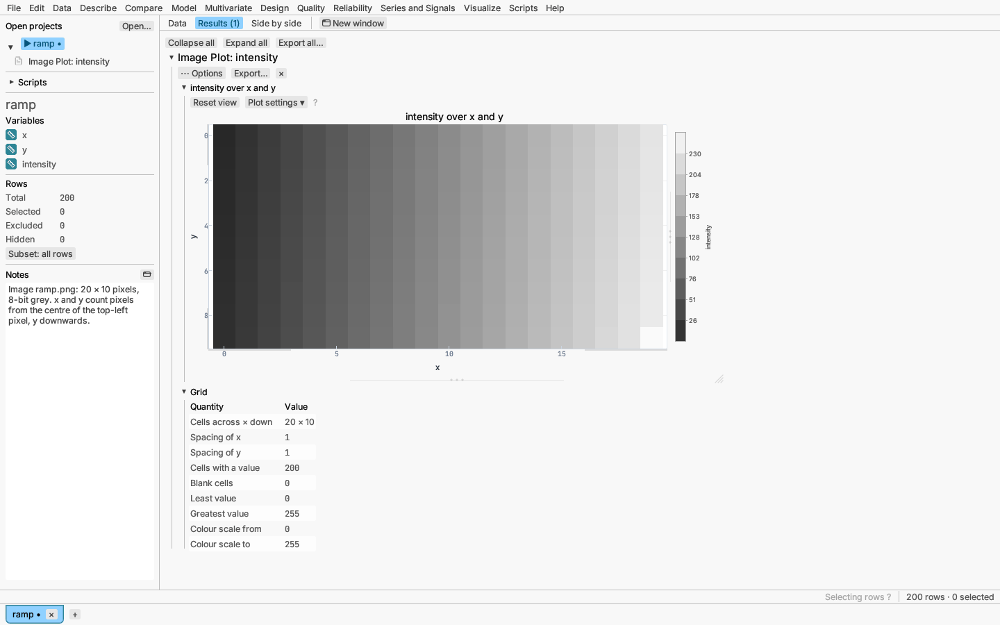
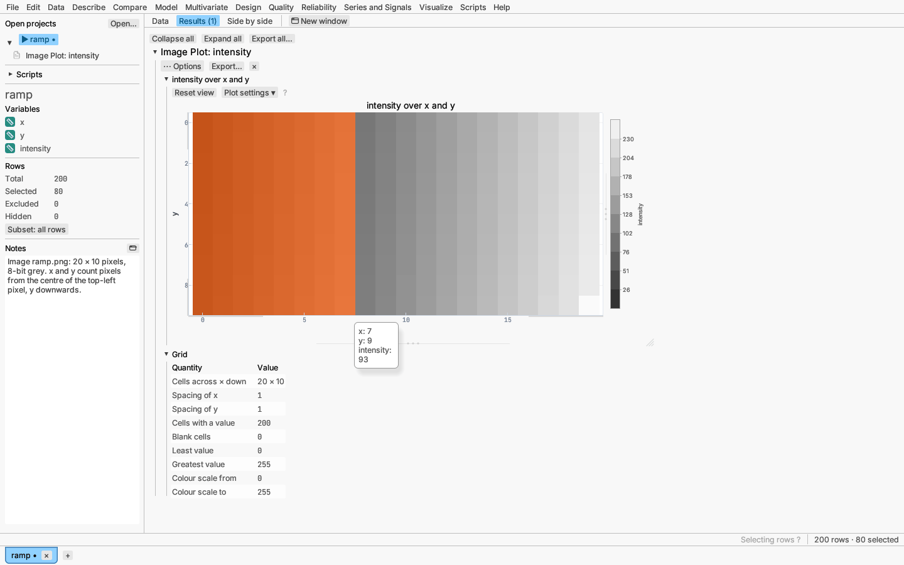

# Image plots

**Visualize ▸ Image plot…** draws a value column as a picture: each row is a
cell placed by its **Across (x)** and **Down (y)** columns on an evenly
spaced grid, coloured by its **Value**. Tables opened from image files are
laid out this way (see [Images as tables](../data/images.md)), and so are
results computed on a grid, such as a field of measurements taken at regular
steps. The dialog fills in `x`, `y` and `intensity` (or `luminance`) when the
table has them.

Cells are drawn as they are, with no smoothing between them, so the picture
shows every pixel exactly. The x and y columns must place the rows on one
grid: the spacing on each axis is the smallest gap between distinct values,
and every value must fall on it. Two rows in the same cell stop the plot with
a message naming them; cells no row fills are left blank.

## Settings

The dialog and the report's **Plot settings** hold the same choices:

- **Colours**: sequential (blue to yellow), heat, spectrum, diverging or grey
  (for print), shown in the colour bar beside the plot. The plot starts in
  grey with **Reverse the colours** ticked, so low values are black and high
  ones white, as in the image file; untick it to run any scale the other
  way.
- **Fixed range**: colour between two values instead of the data range,
  for example to compare several pictures on one scale. Values outside are
  drawn in the end colours.
- **Vertical axis**: **downwards** (as image files store their rows, the
  first row at the top; the default) or **upwards**.
- **Equal scale**: one unit is the same length on both axes, so cells are
  square (on by default).

## Reading and selecting

- Point at a cell to see its position and value.
- **Drag a box** to select the rows of every cell inside it; **click** a
  cell to select its row. The modifier keys add, remove or intersect as in
  other plots, and the selection is shared with the data grid and every
  other view. Selected cells are tinted in the selection colour.

  

- Excluded rows are left blank.
- The axes drag and reset like any other plot's (see
  [Working with plots](plots.md)).

The **Grid** table under the plot gives the grid's size, the cell spacing on
each axis, how many cells are filled and the value range.

## Saving

**Save plot as** writes PNG, SVG, PDF or EPS. The picture goes into the file
as a bitmap, pixel for pixel: PNG data inside SVG, an image object in PDF
(with transparency for blank cells) and an inline image in EPS, with the
axes, titles and colour bar drawn as text and lines around it. Image plots
can also go on a [figure page](figure-page.md). Scripts run the plot as
`image-plot` (see [Scripting](../reference/scripting.md)).
