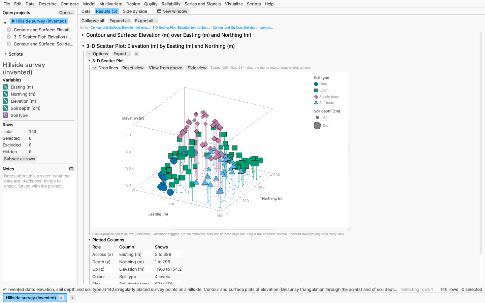
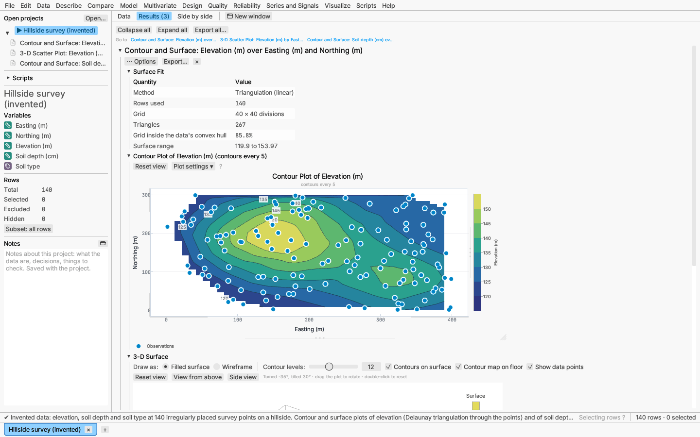

# 3-D scatter, contour and surface plots

Two entries on the **Visualize** menu show a response over two other columns
in three dimensions. The *Hillside survey* sample opens with both plots
already made.

## 3-D scatter plot

Visualize ▸ 3-D scatter plot… places each row in a box by three numeric
columns: **Across (x)**, **Depth (y)** and **Up (z)**. Three optional
columns add more information to each marker:

- **Colour:** a continuous numeric column is shown on a colour ramp with a
  key bar; any other column gets one colour *and* one marker shape per level,
  so the groups stay distinct without colour.
- **Size:** marker area grows in proportion to a numeric column; the key
  shows the smallest and largest values.
- **Shape:** one marker shape per level of a column (used when the colour
  column does not already set the shapes).

Turning and selecting:

- **Drag** inside the plot to turn it; **double-click** or **Reset view**
  returns to the starting angle. **View from above** looks straight down the
  up axis, and **Side view** looks along the depth axis.
- **Shift-, ⌘- or ⌥-drag** draws a selection box, and a **click** selects
  the nearest point; the modifiers combine selections as in the other plots.
  The selection is shared with the data grid and every other plot.
- **Drop lines** join each point to the floor, which helps judge where it
  sits in depth.
- Excluded rows are drawn hollow; hidden rows are left out.
- The plot opens at most about 760 points wide; drag the handles under it
  and along its right edge to resize it, and double-click either to restore
  its size (see [Plots](plots.md#resizing)). The 3-D surface below resizes
  the same way.

The report also lists the plotted columns with their ranges, and how many
rows were left out for missing values.

## Contour and surface plot

Visualize ▸ Contour and surface plot… makes a surface of a **Response**
column over **Across (x)** and **Depth (y)** columns, then draws it as a
contour plot and as a 3-D surface you can turn. Choose how the surface is
made:

- **Triangulation (linear):** joins the observations into Delaunay
  triangles and makes each triangle flat. The surface passes through every
  observation and stops at the edge of the data (the convex hull), so grid
  cells outside the data are left blank.
- **Thin-plate spline (interpolating):** the smoothest surface, in the
  sense of least bending, that passes through every observation (Wahba
  1990). It extends to the corners of the plot.
- **Thin-plate spline (smoothing):** trades closeness to the observations
  for smoothness, with the balance chosen by generalized cross-validation.
  Use it for noisy measurements. The fit table reports the smoothing
  parameter λ, the effective degrees of freedom, the GCV score and the
  residual standard deviation.

Rows that share the same x and y are averaged before the surface is made.
The smoothing spline is then fitted to those averages, so when rows were
averaged its residual sum of squares and residual standard deviation are
labelled *(distinct locations)*: they measure the scatter of the location
averages about the surface on n − df degrees of freedom (n distinct
locations, df the effective degrees of freedom), on the same footing as λ
and the GCV score, not the scatter of single rows.
Under **More options**, **Grid divisions** (8 to 120, default 40) sets how
finely the surface is drawn. The spline methods use at most 1,000 distinct
locations; use triangulation for more.

The **contour plot** shows the surface as a filled contour map with a
colour bar, its contour lines with their levels, and the observations as
points you can select; its Plot settings choose the colours, lines and
levels (see [Contour maps](plots.md#contour-maps)). The 3-D surface, its
floor map and its colour bar use the same colour scale. The **3-D surface** has its
own toolbar: **Filled surface** or **Wireframe**, the number of contour
levels, contours on the surface, a contour map on the floor, and the data
points. It turns and selects in the same way as the 3-D scatter plot.
Hovering over the surface shows the x, y and surface value under the
pointer. The section menu (**⋯** or right-click on the report title)
switches the contour plot and the 3-D surface on or off and changes the
method.

## Saving the plots

Right-click either 3-D plot and choose **Save plot as** PNG, SVG, PDF or
EPS. The file is drawn from the plot itself at the current angle, with the
same markers, key and axes as on screen (see
[Saving plots and results](exporting.md)).

## Scripts

Both plots run from scripts through `run_report` with the analysis keys
`"scatter-3d"` and `"data-surface"`; see
[Scripting and recording](../reference/scripting.md).
