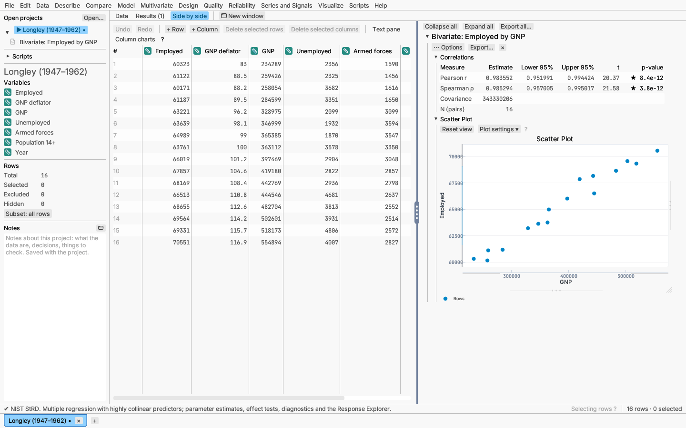
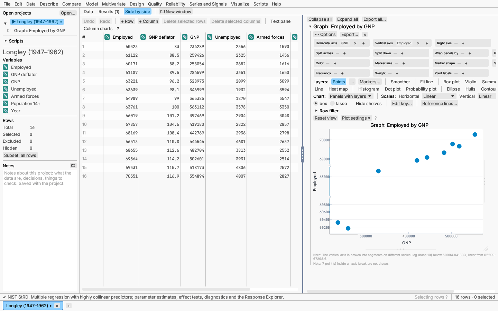
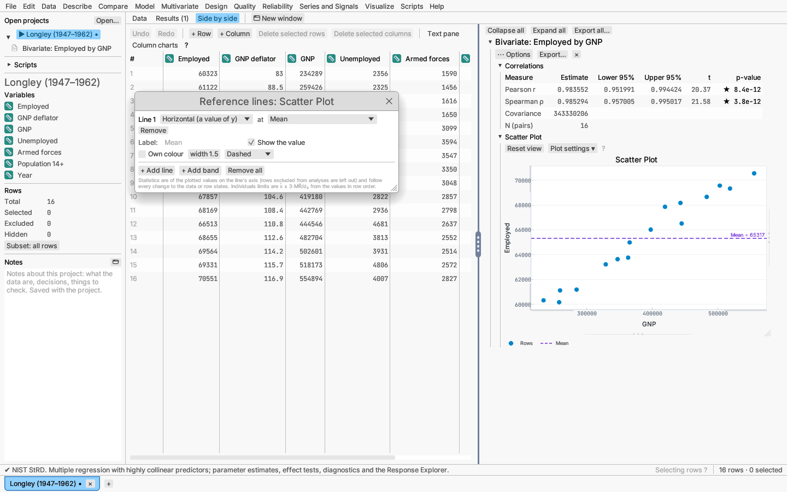
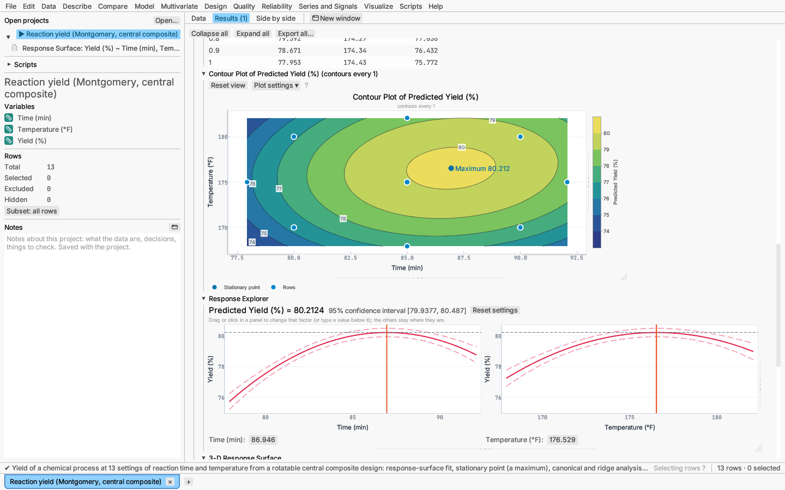

# Working with plots

All plots in reports and on the graph canvas behave the same way.

## Moving and rescaling

Plots never move when you scroll or pinch, so scrolling a long report is
safe. Instead, each axis is a ruler you drag:

- Drag near **either end** of an axis to move that limit only; the value you
  grabbed follows the pointer.
- Drag the **middle** of an axis to shift the whole axis.
- **Reset view** (or double-click the plot) re-fits the plot to its data.

On a plot at equal scale (see Resizing below), dragging the end of one axis
still moves only that limit; the other axis widens or narrows about its
centre to keep one unit the same length on both. On the graph canvas,
dragging one axis fixes that axis's range only; the other keeps fitting the
data.

Dragging inside the plot area selects rows (see below). A short reminder of
these gestures sits above the reports, and each plot's **?** shows it too.

After selecting points, right-click the plot and choose **Zoom to selected
points** to frame them; Reset view goes back.

Resting the pointer on a point in a report plot shows a tooltip with its row
number and its two values (the category's name on a categorical axis), and
notes when the row is excluded.

## Selecting points

Drag a box in the plot to select the rows inside it, or click a point. On the
graph canvas, and in report scatter plots through the plot's right-click
menu (**Lasso selection**), you can also draw a lasso. Shift adds, ⌘/Ctrl toggles and
⌥/Alt removes. Selected points are ringed, so the selection stays visible on
any group colour, and the same rows are highlighted in every other plot and
the grid.

## Plots with very many points

A plot draws one marker for each row, which stays quick up to some tens of
thousands of points. Above **20,000** points (in a report's scatter or
quantile plot, among a box plot's values beyond the whiskers and its
selection rings, or in one layer of the graph canvas) the points are drawn
instead as one picture at the screen's resolution, and a note under the plot
says so. Each pixel takes the colour of the points in it, with opacity
growing with how many there are (on a logarithmic scale, so crowded areas
read darker without hiding single points); excluded rows are drawn first in
their own colour and selected rows last, in the selection colour, slightly
larger. Group colours are kept; marker shapes and the dark theme's halo are
not drawn.

Only the drawing changes. Box, lasso and click selection, hovering and
zooming to the selection work on the rows as before; dragging an axis draws
the picture again for the new view. Saved and copied figures (SVG, PDF, EPS
and PNG) still contain every point.

## Groups

Grouped data use a colour-blind-safe palette, and each group also gets its
own marker shape, so groups can be told apart without colour.

## Plot settings

Each plot's **Plot settings ▾** menu sets titles, axis ranges, major and minor
ticks, the tick origin, grid lines, number format, axis position, equal
scaling of the two axes, and the key. On scatter plots and on the graph
canvas it also sets axis breaks on each continuous axis (see
[Axis breaks](#axis-breaks) below), and on the graph canvas the right axis
when the graph has one (see [Graph canvas](graph-canvas.md)).

These settings are kept with the plot: saving the project, adding the report
to a dashboard or copying its script call keeps them, and reopening draws the
plot as you left it. A plot whose settings are all back at their defaults
stores nothing. Ranges typed into the **min** and **max** fields are kept
(the row then shows **fixed** and an **Automatic** button that lets the
axis fit the data again); ranges you only drag to are not kept, and reopened
plots fit their data again. **Reset view**, a double-click on the plot and
**Fit view to data** clear typed ranges too.

### Ticks

Each axis section has a **Ticks** group:

- **Tick direction** — **Inside** (the default) points the marks into the
  plot, **Outside** away from it towards the labels, **Across** half each
  way. Labels move out to make room for outside marks.
- **Major marks** and **Minor marks** — length and thickness in points
  (5 and 1 for majors, 3 and 1 for minors). Minor marks are drawn whenever
  the axis has minor ticks (set under **Minor ticks**).
- **Tick labels** — your own labels, each a value and a text read as math
  markup (`\pi` draws π, `10^3` a superscript). A label at a tick's value
  replaces its number; anywhere else it adds a labelled tick of its own.
  **Add a tick at…** adds a row to fill in; ✕ removes one. An empty label
  leaves the tick unlabelled.

On the plot itself, double-click a tick label (or right-click the axis ▸
**Edit tick label…**) to write that tick's label in place: **Apply** (or
Enter) keeps it, **Use the number** goes back to the number, **Cancel** (or
Escape) leaves it as it was. Where no labelled tick is near, the editor adds
a tick at the value under the pointer.

### Spine

The **Spine** group of each axis has:

- **Offset from data** — moves the axis line, its marks and labels away from
  the data area by up to 40 points, a style common in scientific figures.
  The draggable axis ruler moves with the line.
- **Extend to nearest ticks** — widens an automatic range to the major ticks
  just outside it, so the axis starts and ends on a labelled value (off by
  default, when ranges keep their usual 6% padding). Typed or dragged ranges
  are left as they are.

### Plot area

Besides **Equal scale**, the **Plot area** section sets a **Scale ratio**
(one x unit drawn as long as *r* y units; 1 is equal scale) and a **Print
scale**: saved figures draw one horizontal unit *N* millimetres long, so a
printed figure can be measured with a ruler (report plots; the page grows
or shrinks to fit the range shown).

Saved SVG, PDF, EPS and PNG figures draw the axes with these settings: tick
direction, length and thickness, offsets, your tick labels (in markup), and
on report plots also the tick intervals, minor ticks, number format, grid
lines and the side each axis is on, so a saved figure matches the screen.

## Copying a plot's style

Right-click a plot (or its section heading) and choose **Copy plot style**
to keep its settings for the session; a graph canvas has it in its ⋯
Options menu and in its plot's right-click menu. Then right-click any other
plot ▸ **Paste plot style**. The submenu names the plot the style came from
and has a tick for each part that goes across:

| Part | What it carries |
|---|---|
| Axis ranges | The typed minimum and maximum of each axis (off at first: ranges belong to one plot's data) |
| Ticks, grid and spines | Tick spacing and marks, minor ticks, your tick labels, number format, grid lines, axis sides and offsets, category label direction, equal scale and its ratio, print scale |
| Font and size | The plot font, text size, saved figure size and background |
| Colours and markers | Marker and line colours, shapes and sizes (between graph canvases) |
| Reference lines | Reference lines and shaded bands |
| Key | Whether the key shows, where it sits (graph canvases), and renamed, hidden or reordered entries |

Titles, axis breaks and annotations never go across: they describe one
plot's data. Paste **Onto this plot**, **Onto every plot in this report**
(collapsed sections too) or **Onto every plot in this project** (every
report and graph canvas of every table in the project). Report plots and
graph canvases share axes, fonts, reference lines and the key; colours,
markers and the key's placement exist only on canvases. The pasted settings
are the plot's own from then on and are saved with it.

On a plot with categories along the horizontal axis (a bar chart, Pareto
chart, control chart, or a plot against a categorical column), **Category labels** sets how their names
are drawn: **Automatic** (the default) keeps them level when they fit,
slants them at 45° when level names would overlap, and stands them upright
when even slanted ones would; **Horizontal**, **Slanted (45°)** and
**Vertical** fix the direction. The axis grows to make room for turned
names. Only when even upright names would overlap is every second or third
one shown. Exported figures follow the same setting.

### Axis breaks

On a scatter plot in a report (and on the graph canvas), each continuous
axis has an **Axis breaks** row: tick **Leave out** to leave a stretch of
the axis out, **Add a break** for more, and open **Segments and marks** to
put a piece on a scale of its own (a log piece below a linear one, say),
give a piece a fixed share of the axis, or choose slashes or a zigzag for
the marks. Points inside a break are not drawn and a note under the plot
counts them; a note also names the scales when the pieces use different
ones. Tick labels come from each piece's own values, hovering a point shows
its data values, and box and click selection pick what is drawn. Axes
labelled by categories, probability scales or dates, plots divided into
panes, contour maps and ternary plots take no breaks. The full description
is under [Graph canvas ▸ Axis breaks](graph-canvas.md#axis-breaks). Breaks
are kept with the plot, and saved figures draw them as on screen.

## Reference lines and bands

**Reference lines…**, in the plot's **Plot settings ▾** menu and in its
right-click menu, adds horizontal or vertical lines and shaded bands to a
report plot (scatter and fit plots, control charts, box plots, survival
curves, bar and Pareto charts) or a graph canvas.

- **+ Add line** adds a dashed line. Choose *Horizontal* or *Vertical*, then
  where it sits: a **Typed value**, or a statistic of the plotted values on
  that axis: **Mean**, **Median**, **Quantile** (with its percentage),
  **Mean ± k standard deviations** (with k; a negative k is below the mean),
  or the **Individuals chart** centre line, upper or lower limit
  (x̄ ± 3·MR̄/d₂, from the values in row order). Each line has its own label (empty: its value or
  statistic), colour, width and pattern (solid, dashed, dotted or
  dash-dot). *Show the value* adds the number after the label.
- **+ Add band** adds a shaded stretch between two values, each typed or a
  statistic, drawn behind the data with its fill colour and opacity. *Edge
  lines* draws its two edges; *Edge values* writes their values beside them.
  A band has an entry in the key, a filled square with its label.

Statistics leave out rows excluded from analyses and follow every change to
the data or the row states, so a line at the mean moves when rows are
excluded. On the graph canvas a statistic is computed for **Whole
graph**, **Each panel** (the default) or **Each subgroup**, the last drawing
one line per colour group in the group's colour and naming it in the label.
Lines are drawn on top of the data, bands underneath; the default view
widens to show a line that falls outside the data. A statistic needs a
continuous axis; on a categorical or date axis, type the value. A value
that cannot be drawn on the axis (such as a negative value on a log axis)
is left out with a note under the plot.

Lines and bands are saved with the plot (as `reference_lines` in its plot
style), and appear in saved plot images and on figure pages.

## Contour maps

The contour plots of the response surface, mixture (ternary), nonlinear
surface and contour-and-surface reports colour the bands between contour
levels and show a **colour bar** beside the plot with the level values at
the boundaries between its boxes. The level lines and their values stay
on top, so the map still reads without colour.

The end of the plot's **Plot settings ▾** menu holds the contour options.
They apply to every contour plot of the report (and to the colours of the
3-D surface in a contour-and-surface report), and they are saved with the
project, in dashboards and in exports:

- **Fill between levels**, **Level lines** and **Level values** switch the
  three layers on or off. **Lines only** gives the plain look of level lines
  and values with no fill; **Default** goes back to the filled map.
- **Colours** chooses the scale:
  - *Sequential (blue to yellow)*: lightness rises steadily, so high and
    low read in grayscale too. The default.
  - *Heat (yellow to red)*: pale yellow through orange to dark red
    (after Brewer's yellow–orange–red scheme).
  - *Spectrum (blue to red)*: blue, cyan, green, yellow, orange and red, the
    usual choice for elevation and response maps. It is not colour-blind
    safe, and its lightness does not rise steadily, so keep the level lines
    and values on with it.
  - *Diverging (blue, neutral, red)*: blue below a centre value, a light
    neutral at it and vermillion above, for a response with a target.
    **Centre at** sets the value in the middle (by default the middle of the
    range); the farther end of the range takes the strongest colour.
  - *Grey (for print)*: white to near black.
- **Reverse colours** runs the scale from high to low.
- **Opacity** fades the fill (0.2 to 1), for example to see the grid.
- **Number of levels** sets about how many levels to draw, at round values
  (steps of 1, 2, 2.5 or 5 × 10ⁿ); unticked, each plot keeps its own number.
  A title that says *contours every …* follows the new step.
- **Fixed range** spans the levels and colours over a range you type
  instead of the surface's own, so maps of different responses or data can
  be compared colour for colour. Parts of the surface outside the range take
  the end colours.

Each band is coloured at its middle value. In dark mode the colours lean a
little towards the dark canvas. Points over a filled map get a rim in the
canvas colour, and selected and excluded rows keep their ring and cross.

The bands are true shapes, not pictures: **Save plot as** SVG, PDF or EPS
writes each band as one filled outline (with holes where the band surrounds
a higher or lower region), and PNG renders them, so a saved map matches the
screen. The method: the surface is taken as linear over the triangles of
its grid (each grid cell is split into four triangles around its centre,
whose value is the mean of the corners), so each band is cut from each
triangle exactly and the pieces join without gaps; the level lines are cut
from the same triangles and lie on the bands' edges.

## Math in labels

A title typed in **Plot settings** (the plot title or an axis title) is read
as a small markup, so it can carry subscripts, Greek letters and fractions.
The same markup is set in saved SVG, PDF, EPS and PNG figures, and in the
vertical title of the y axis.

| Type | To get |
|---|---|
| `x_1`, `x_{ij}` | a subscript: one character, or a group in braces |
| `x^2`, `e^{-t}` | a superscript |
| `x_i^2` | a subscript and a superscript at the same place |
| `\alpha`, `\beta`, `\mu`, `\sigma`, … | Greek letters by name; a capital first letter gives the capital (`\Delta`, `\Sigma`) |
| `\pm`, `\times`, `\cdot`, `\le`, `\ge`, `\ne`, `\approx`, `\infty`, `\partial`, `\deg` | ±, ×, ·, ≤, ≥, ≠, ≈, ∞, ∂, ° |
| `\frac{a}{b}` | a fraction, a over b with a rule between |
| `\sqrt{x}` | a square root, the radical sign as tall as what is under it |
| `\sum`, `\prod` | Σ, ∏ |
| `$a/b$` | inside dollar signs a slash is a fraction too; outside them `/` is an ordinary slash |
| `\_`, `\^`, `\{`, `\}`, `\$`, `\/`, `\\` | the character itself |

For example `Yield (kg m^{-2})`, `\sigma_{within}` or
`$\Delta y / \Delta x$`. Scripts are set at 70% of the text size, fraction
parts at 80%. A title with none of `_ ^ \ $ { }` is drawn exactly as plain
text. Something the markup cannot read — an unknown name such as `\foo`, a
`_` or `^` with nothing after it, an unmatched `$` — is shown as typed.

Default titles (column names) are shown as written. On the graph canvas,
**⋯ Options ▸ Read math markup in column names, levels and labels** reads
them as markup too, along with key entries and text labels, so a column
named `x_1` gets a subscript.

## Resizing

Every plot can be resized by dragging the faint handles beside it:

- the strip under the plot changes its height;
- the strip along its right edge changes its width;
- the corner where the two meet (marked with diagonal lines) changes both.

Double-click either strip to go back to the default size. A plot is never
made wider than the visible part of the pane, so the whole of it stays in
view. The same handles resize the 3-D scatter and surface plots, the plots
of the graph canvas, and the panels of a Response Explorer, where one strip
under the panels resizes them all together (see
[Response Explorer](response-explorer.md)).

Plots of one variable against another, and the 3-D plots, open at most
about 760 points wide (wider with larger text), so a wide window does not
flatten them into a strip; drag a plot's right edge to widen it. Plots whose shape depends on
equal units on both axes open at equal scale: observed against predicted or
fitted values, probability plots against the line y = x, and score plots.
Turn equal scaling off in Plot settings. Control
charts, Pareto charts, bar charts and box plots use the full width.

Drawings laid out to fit their text (correlation heat maps, decision trees,
cause-and-effect diagrams and the Effect Pareto) have no size handles: they
grow with the text size instead, and scroll sideways when wider than the
pane.

The key below each plot names what each line, band and marker shows: a
fitted model line is "Fit", but reference lines and curves carry their own
names ("Reference line y = x", "4/n threshold", "OC curve", "Mean
difference", "Limits of agreement"). Category names that would overlap
are turned rather than dropped (see **Category labels** under Plot
settings).

By default, plots draw horizontal major grid rules only, and axis ranges
frame the data with a little padding (6% per side), keeping a zero baseline
when all the data are non-negative. Points at or just above zero (a 0/1
response, the leaves of a dendrogram, Cook's distances) get padding below as
well, so the frame
does not cut them in half, and categorical axes leave half a category beyond
the first and last. Date axes tick on calendar units instead, and axes that
count samples or subgroups tick on whole numbers only. A tick label that would
be cut off at the top of the vertical axis, or run into the corner at the left end of the horizontal axis, is left out.

Labels drawn inside a plot keep clear of each other: group names at the ends
of survival curves and run-rule numbers on control charts move up or down
where they would collide, and on a Pareto chart a cumulative percentage that
would run into the one before it is left out (hover over its bar to read it).
Specification limits and other reference lines on a histogram are named
beside their lines, near the top, rather than across them.

## Themes

Plots follow the light or dark colour scheme (File ▸ Settings…). In dark
mode, points get a soft halo so they stand out, the darkest group colours (the
first, blue, and the grey) are lightened so they stay visible on the dark
canvas, and the zero line of residual plots is a neutral grey in both modes.
