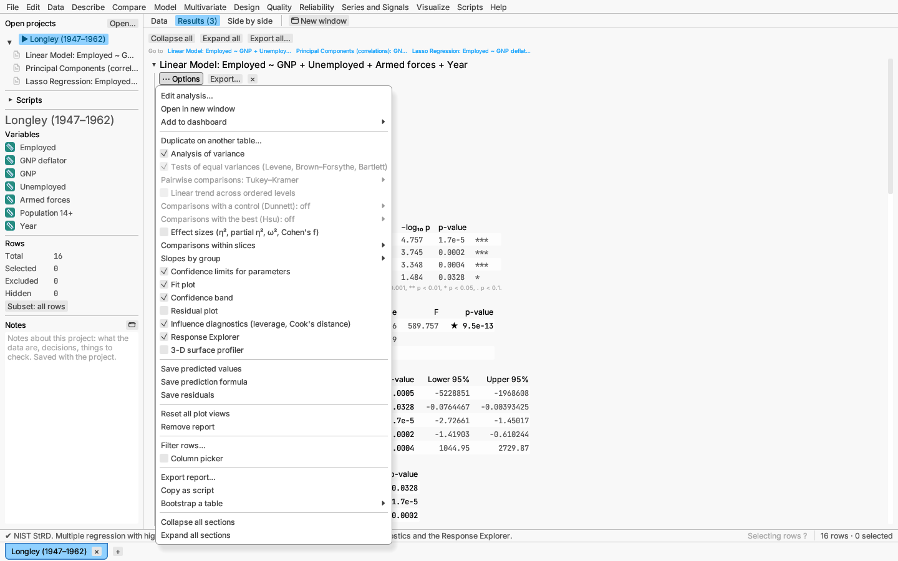
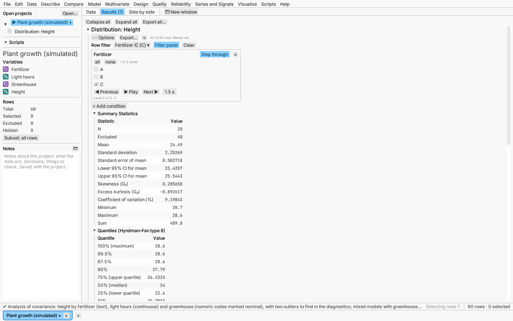
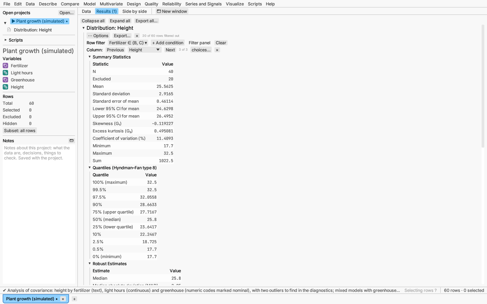

# Reading a report

Each analysis produces a **report**: a tree of collapsible sections, such as
fit statistics, parameter estimates, test tables and plots. Reports appear
on the document's **Results** tab (newest first) and in **Side by side**
view.

## Sections

Click a section's heading to collapse or expand it. Numeric table cells use a
monospaced font, so digits line up.

**Collapse all** and **Expand all**, above the reports, close every report
down to its title or open every report and all its sections. **Export
all…**, beside them, saves all of the table's reports (or the ones you
pick) as a document; see
[Saving plots and results](exporting.md#whole-reports-as-documents). The × beside a
report's ⋯ Options button removes that report; for 30 seconds the status bar
offers **Undo remove**, which puts it back where it was. When rows are
excluded, a faint "N of M rows excluded" note sits beside the buttons;
click it to select the excluded rows.

With two to four reports, a **Go to** line lists their titles (newest
first); click one to open that report and scroll to it. With more, a **Go to
▾** list beside the buttons holds the titles instead, so the line never wraps.

P-values below 0.05 in report tables are marked with a ★ in strong text, so
they stand out without relying on colour. Turn this off in File ▸ Settings…
(Mark p-values below 0.05 with ★). Settings can also separate thousands
with commas (184,150,146) and line up the decimal points in each column.
Copied tables carry the plain numbers. While the getting-started tips are on,
the line beside the buttons is a reminder of how to work the plots; the **?**
beside each plot shows the same reminder.

## The options menu

Each report has a **⋯ Options** menu, also opened by right-clicking the
report's heading or any section heading. It:

- **Edit analysis…** (at the top of the menu, and when right-clicking the
  report's heading) reopens the report's dialog with its settings filled in;
  **Update** changes the report in place (see
  [Using analysis dialogs](../getting-started/dialogs.md#editing-an-analysis));
- **Open in new window** (just below it, also on the report heading's
  right-click menu) shows the report in a window of its own; in that window
  the item reads **Back to main window** (see
  [Views in windows of their own](../data/documents.md#views-in-windows-of-their-own));

- adds or removes optional sections in place (diagnostics, extra tests,
  plots). The chapters on each analysis list its options;
- saves columns the report offers back into the table, such as predicted
  values, residuals, component scores or cluster numbers;
- **Filter rows…** narrows this report alone to chosen rows, and **Column
  picker** steps it through other columns (see
  [Filtering a report and switching its column](#filtering-a-report-and-switching-its-column));
- **Copy as script** copies the script call that recreates this report (see
  [Scripting and recording](../reference/scripting.md));
- **Collapse all sections** and **Expand all sections** close or open every
  section of this report at once;
- **Reset all plot views** re-fits every plot in the report;
- **Remove report** closes it.

Right-clicking the heading of a plot section also offers to save the plot
(see [Saving plots and results](exporting.md)).

## Filtering a report and switching its column

**⋯ Options ▸ Filter rows…** gives a report a row filter of its own. A
**Row filter** line appears under the report's title: **+ Add condition**
lists the table's columns. A categorical column becomes a condition with a
check box per level; a continuous one becomes a **from** / **to** interval
(ends included). Each condition shows as a button such as
`Region ∈ {East, West}` or `20 ≤ Age ≤ 40`; click it to change the levels or
the interval, or to remove the condition. A row must pass every condition.
**Clear** (or ⋯ Options ▸ **Remove row filter**) takes the filter away.

**Filter panel** on the same line opens the conditions as a form under it:
each condition in a box with its column's name, a list of its levels with
**all** and **none** (a categorical column) or a **from** and a **to**
slider (a continuous one), and **×** to remove it; **+ Add condition** sits
at the bottom. **Step through** on a condition shows one slice at a time:
a categorical column one level at a time, a continuous column a window of
fixed width (the interval you set, or a tenth of the column's range when
the interval spans all of it) moved along by its own width. **◀ Previous**
and **Next ▶** step by hand and wrap round at the ends; **▶ Play** steps on
by itself at the number of seconds shown (0.2 to 10) until **⏸ Pause**. A
note such as "Level 2 of 3: B" or "Window 4 of 10: 1950 ≤ Year ≤ 1951.5"
says where it stands. Each step recomputes the report, so this shows how an
analysis changes across the levels of another column, in the manner of
Cleveland's conditioning plots (*Visualizing Data*, 1993). Adjacent windows
share their end points, so a value exactly on a boundary appears in both.
The steps are ordinary filter edits: the filter shown when you save is the
one saved.

The filter changes this report only. The rows it leaves out are not excluded
or hidden in the table, so the data grid and every other report still use
them. The report recomputes from the rows that pass (an interval dragged with
the mouse applies when you let go), its plots leave the other rows out, and a
faint "N of M rows filtered out" note beside the title says how many it left
out. Selecting points in a filtered report still selects those rows
everywhere. The filter is saved with the report in a project and in
**Copy as script**, and a column used by a filter cannot be deleted while the
report is open (a renamed column is followed).

Reports built around one response or measured column (linear, generalized
linear, penalized and stepwise models; distributions; control charts and
capability studies; bivariate fits, whose Y column switches; multi-vari
charts and analysis of means) also offer **⋯ Options ▸ Column picker**. A
line under the title shows the column now in that role, with **Previous**,
**Next** and a list to pick another, and "2 of 6" for its place in the list.
Choosing a column recomputes the report on it, with every other setting
kept, so you can step one analysis through many columns. The list starts
with every column of the same kind (numeric or text) that the report does
not already use in another role; **choices…** ticks which ones it holds, and
**×** removes the picker. For a capability study, the line below holds
the **specification limits for** the column shown: each column keeps its own
limits as you step through, and a column seen for the first time starts with
the limits of the one before. A generalized linear model's event level goes
back to its default when the response changes.

The same reports take a column dropped on a plot axis. Drag a column from
the variables list over a plot: an axis whose title is the report's own
column (the response of a model's fit plots, the column of a distribution's
histogram or a control chart's values) is outlined, and a note beside the
pointer says "Analyse Weight instead of Height". Letting go there switches
the report to that column, just as choosing it in the column picker does
(the picker need not be on). A column of another kind, or one the report
already uses in another role, is refused with a note saying so; axes that
show other quantities (counts, residuals, quantiles) take no drops.

## Reports stay current

A report is bound to its table's data and row states. Editing the data or
excluding rows re-runs it. Projects store each report's request and display
options, and reopening the project re-runs it exactly.

Reports are computed in the background, so typing in the grid, excluding
rows or scrolling never waits for a slow analysis. A report that takes more
than a moment shows a spinner and **Updating…** in its title bar, with its
previous result dimmed beneath until the new one arrives. Analyses with many
repeated steps (random forests, boosted trees, Bayesian sampling, bootstrap
intervals, the model search) count them: **Updating… 120 of 500**.

**Cancel** in the title bar stops the computation. The report keeps its
previous result and says **Computation cancelled**; **Compute again** starts
it once more. A further edit to the data also starts it again. When rows were
added, removed or reordered, the previous result no longer lines up with the
table, so the report shows a short note instead of it until the new result
arrives.

If an analysis stops with an unexpected error, the report keeps its previous
result and shows the error above it; the rest of the app carries on.
New reports, and the reports of a project being reopened, appear at once and
fill in as they finish. Exporting reports first finishes any that are still
updating, so exported files always hold current results.

## Model reports

Every model report includes an **Effect Pareto**, a bar chart of −log₁₀ p for
each effect, so the strongest effects stand out. Models keep the hierarchy
principle: an interaction or a power implies its lower-order effects. Model
dialogs enforce it, stepwise selection respects it, and a report notes when
a model breaks it.

Linear, generalized linear, penalized, nonlinear and decision tree reports end with a
**Prediction Formula** section showing the fitted equation, with a **Copy
formula** button. **Save prediction formula** writes it as a
[formula column](../reference/formulas.md), so predictions follow edits to the
data and are computed for new rows.
