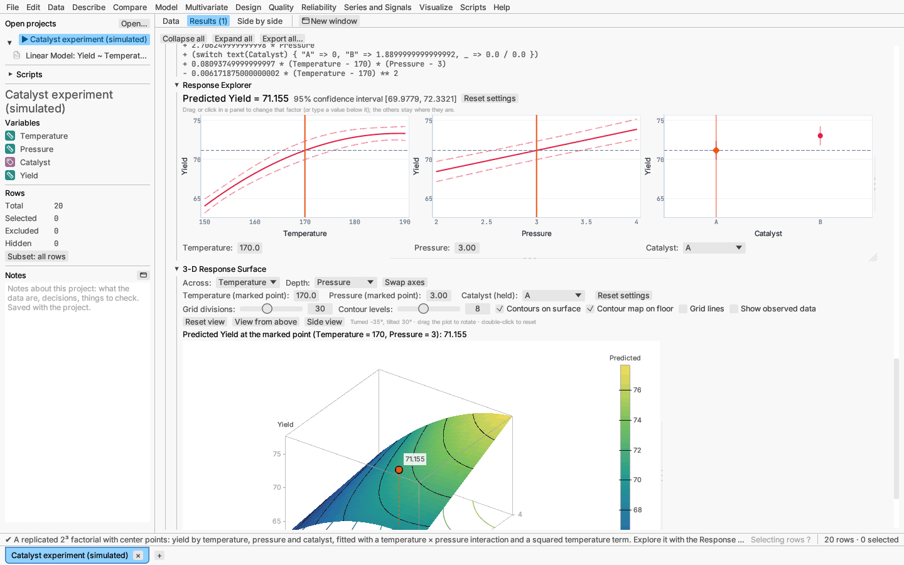

# Response Explorer and 3-D profiler

## Response Explorer

For a fitted model, the Response Explorer shows a row of slice plots, one per
factor. Each plot shows the predicted response as that factor varies, with a
confidence band, while the other factors are held at their current settings.

- Drag a factor's vertical reference line (or click in its panel) to change
  its setting. Every panel and the predicted value update as you drag. You
  can also type an exact value below each panel.
- A categorical factor's panel shows the prediction at each level with its
  confidence interval; click a level to choose it.
- All panels share one vertical scale, so you can compare the size of each
  factor's effect directly. Penalized fits are shown without bands.
- A button returns to the starting settings: continuous factors at their
  means, categorical factors at their most common level.
- In a **mixture** model, moving one component rescales the others so the
  mixture still sums to one.
- In the **several responses** report there is one row per response, plus a
  row for the overall desirability, all linked (see
  [Model: several responses](../analyses/several-responses.md)).
- The panels share one size. Drag the strip under them to make every panel
  taller or shorter together; drag its right-hand corner, or the strip beside
  the last panel, to make every panel wider or narrower. Double-click the
  strip to go back to the default size, which fills the pane's width. Panels
  that no longer fit side by side wrap onto another row. The size is kept
  for each report while the application is open, and a saved figure uses it.

Add it from a model report's ⋯ Options menu. It is available for linear,
response-surface, mixture, generalized linear (population level for mixed
models), penalized, decision tree, random forest, boosted tree, partial
least squares, support vector machine and adaptive regression spline
models, for the model chosen by stepwise selection, for proportional
hazards (the hazard ratio, or survival at a chosen time) and for parametric
survival regression (a predicted percentile). Right-clicking the 3-D
profiler saves the surface at its current angle and settings.

## 3-D surface profiler

The 3-D surface profiler draws the fitted surface over two continuous factors,
with the observed points. Drag to rotate it. Other factors are held at their
current settings. Resize it with the handles under it and along its right
edge, as any other plot (see [Plots](plots.md#resizing)).

Both views can be saved as figures from their right-click menu (see
[Saving plots and results](exporting.md)).
